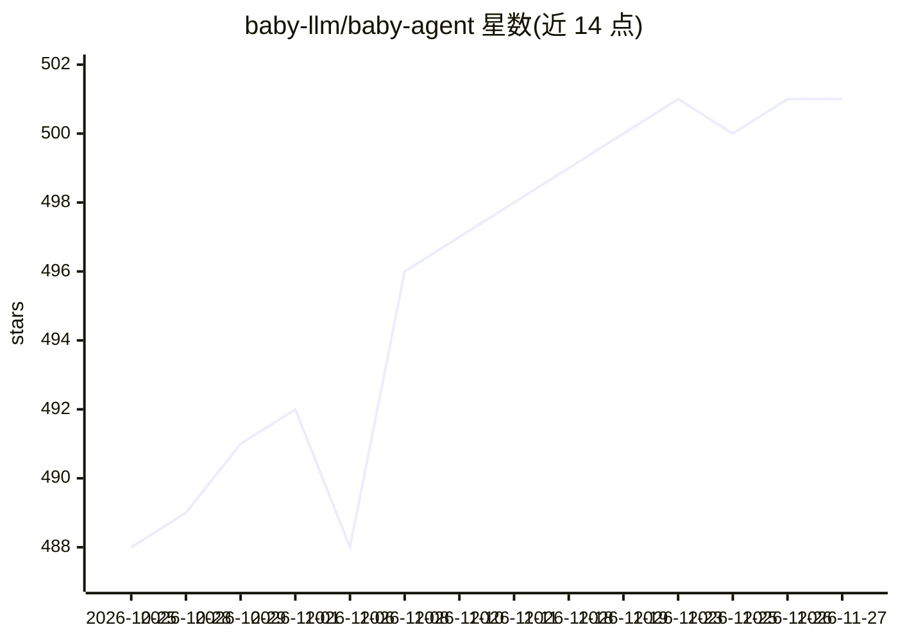

# baby-llm/baby-agent

⭐ 501 · Go · Apache-2.0 · 推送 2026-11-02 · [GitHub](https://github.com/baby-llm/baby-agent) · 组织维护 · 中文 README

**面向无 AI 背景后端工程师的 Go 语言 Agent 教学项目**

以 12 章可运行代码从零讲解 Agent 核心机制：LLM 调用与 SSE 流式解析、Function Calling 与 ReAct Agent Loop、MCP 接入、上下文工程、记忆系统、Agentic RAG、Docker 沙盒防护、技能插件、Web 服务化、可观测性与 LLM 评测。README 明确声明其为教学仓库，不是生产框架，不建议用于生产二次开发；各章代码相互独立，ch07 需 PostgreSQL + pgvector，ch12 使用 Mock LLM 无需 API Key。

## 筛选速览

| 维度 | 判定 | 备注 |
|---|---|---|
| AI 角色 | `ai-knowledge` | 知识聚合/清单类 |
| 许可风险 | `permissive` | Apache-2.0 |
| 部署形态 | `None` |  |
| 模型依赖 | — | README 未给出锁定关系 |
| 硬件要求 | — | 无带数字的原话,不猜 |
| 安装摩擦 | `low` | 无编译、无系统依赖或容器化 |
| 成熟度 | `idea` | |

## 能力要点

- 12 章可运行代码覆盖 Tool Calling、MCP、Memory、RAG、Guardrails、评测全链路
- 基于 Go 1.25+，通过 fork 的 openai-go SDK 原生支持 reasoning_content
- ch08 提供 Docker 沙盒隔离与人工确认机制示例
- ch11 采用 OpenTelemetry + Jaeger/Tempo + Prometheus + Grafana 链路

## 适用场景

- 作为后端工程师理解 Agent 原理的学习路径
- 落地真实业务前用其章节代码做原型验证与原理参考
- 按需单独运行某一章示例学习对应机制

## 场景标签

`教程课程` · 领域:学习与行业

## 证据(README 行号)

> L1: # BabyAgent - 后端工程师的 AI Agent 教学项目 (Go 语言版)
> L11: > - 本项目是**教学仓库**：目标是用可运行的代码把 Agent、Tool Calling、Agent Loop、MCP、Memory、RAG 等机制讲清楚。
> L25: ## 🗺 学习路径图 (按知识循序渐进)

## 星数曲线

2026-10-25 488 → 2026-11-27 501（+13）

---
*卡片 v1 · prompt 1.4 · 生成 2026-11-25 · 置信度 high · 依据 README sha `da1fdf6a260e` · [字段定义](../../DATASET.md)*
