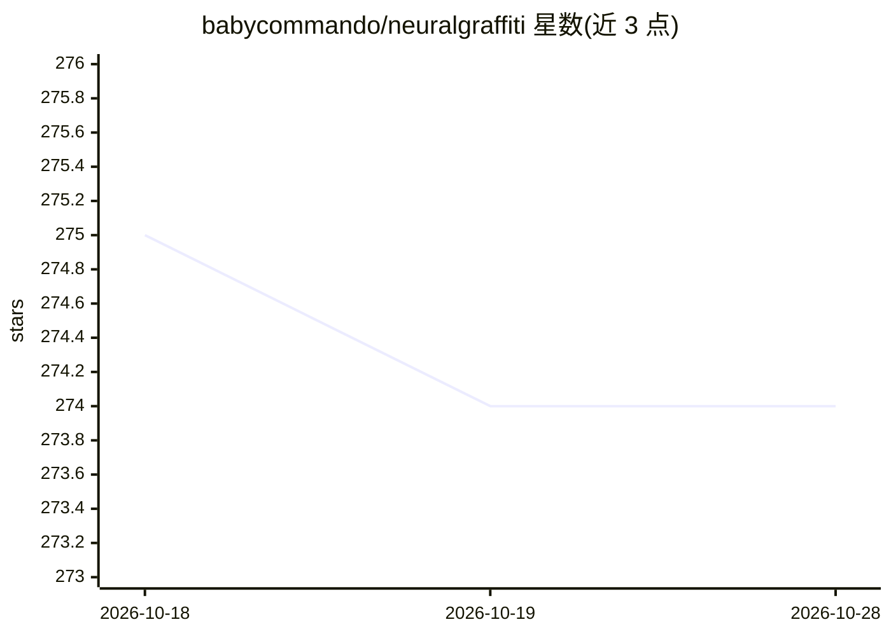

# babycommando/neuralgraffiti

⭐ 274 · Jupyter Notebook · 推送 2026-08-30 · [GitHub](https://github.com/babycommando/neuralgraffiti) · [官网](https://colab.research.google.com/drive/1EeJ-8nzKIOdHaK8jhMdB0jgwnTsSfN-8?usp=sharing) · 个人维护

**给预训练 LLM 实时注入神经可塑记忆的实验层**

Neural Graffiti 是一个实验性 PyTorch 层，将液态神经网络思想与静态 transformer 结合：通过 Spray Layer 在推理最后阶段直接向隐藏状态注入记忆痕迹，无需微调或重训即可实时改变预训练模型的行为倾向。该层随交互缓慢演化，产生基于历史上下文的行为漂移，并可测量其对每次输出的影响强度。兼容任何暴露隐藏状态的模型。README 自述为实验性、结果尚未发布，且提示可能不适合商业部署。提供 Colab 演示与 Medium 文章。

## 筛选速览

| 维度 | 判定 | 备注 |
|---|---|---|
| AI 角色 | `ai-ecosystem` | LLM/agent 周边工具 |
| 许可风险 | `none` | — |
| 部署形态 | `None` |  |
| 模型依赖 | — | README 未给出锁定关系 |
| 硬件要求 | — | 无带数字的原话,不猜 |
| 安装摩擦 | `low` | 无编译、无系统依赖或容器化 |
| 成熟度 | `idea` | |

## 能力要点

- 无需微调/重训，在推理阶段实时注入记忆痕迹
- 兼容任何暴露 hidden states 的 transformer 模型
- Spray Layer 随交互演化并积累内部记忆
- 可测量记忆层对每次输出的影响强度

## 适用场景

- 让预训练 LLM 在交互中形成持续的行为倾向漂移
- 构建带累积'个性'的数字人格模型
- 研究 transformer 推理阶段的向量级干预

## 场景标签

`Agent 记忆` · 领域:Agent 开发

## 证据(README 行号)

> L12: This is an experimental layer that merges ideas from liquid neural networks with static transformer models, using a
> L13: Inspired by graffiti art of tagging and the neuroplastic nature of living brains, this layer injects a memory trace
> L21: Inspired by the neuroplastic nature of living brains, this layer injects or "sprays" a memory trace directly into t

## 星数曲线

2026-10-18 275 → 2026-10-28 274（-1）

---
*卡片 v1 · prompt 1.4 · 生成 2026-10-22 · 置信度 high · 依据 README sha `d0efb4b7d2af` · [字段定义](../../DATASET.md)*
