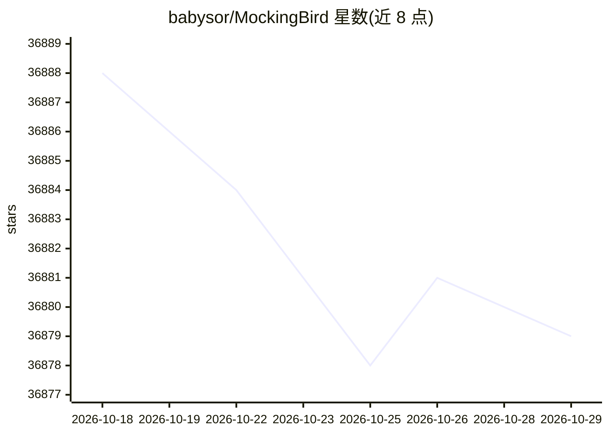

# babysor/MockingBird

⭐ 36,879 · Python · NOASSERTION · 推送 2026-03-03 · [GitHub](https://github.com/babysor/MockingBird) · 个人维护 · 中文 README

**给需要中文语音克隆的用户：5秒音频实时合成任意语音**

基于 SV2TTS 的中文语音克隆工具箱，由 encoder、synthesizer、vocoder 三部分组成，支持用多套中文数据集（aidatatang_200zh、magicdata、aishell3 等）训练或使用社区共享的预训练模型。提供 Web 服务（web.py）、图形工具箱（PyQt5）与命令行三种使用方式，可复用预训练 encoder/vocoder 仅重训 synthesizer。README 注明作者已不再积极更新，转向商业化项目 noiz.ai；demo_cli 在中文预训练模型下不可用，需额外 synthesizer 模型。

## 筛选速览

| 维度 | 判定 | 备注 |
|---|---|---|
| AI 角色 | `ai-native` | 本体是模型或模型工具 |
| 许可风险 | `none` | NOASSERTION |
| 部署形态 | `library` | 以包/库形式分发 |
| 模型依赖 | — | README 未给出锁定关系 |
| 硬件要求 | — | 无带数字的原话,不猜 |
| 安装摩擦 | `medium` | 含编译或系统依赖之一 |
| 成熟度 | — | 结构信号不足 |

## 动量与使用信号

- 维护:`declining` — 距上次 push 228.7 天,年发版 0,37 位贡献者
- 涨星:近 1 天 **-1**(自 20261016 起算)
- 安装:pypi 包 `webrtcvad-wheels` 月下载 1,104,144
- 平台:WINDOWS / MACOS / LINUX · 协议:—

## 能力要点

- 支持中文普通话，可在多套中文数据集上训练
- 提供 Web 服务、桌面工具箱与命令行三种入口
- 可复用预训练 encoder/vocoder，仅训练新 synthesizer
- 支持 Windows、Linux 及 M1 macOS（x86 转译方案）

## 适用场景

- 用几秒目标说话人的音频生成中文语音
- 在自己的中文语音数据集上训练定制化合成模型
- 通过 Web 界面在浏览器里体验克隆语音效果

## 场景标签

`语音合成` · 领域:内容生成

## 证据(README 行号)

> L11: 🌍 **Chinese** supported mandarin and tested with multiple datasets: aidatatang_200zh, magicdata, aishell3, data_ais
> L166: |**1806.04558**|**SV2TTS**|**Transfer Learning from Speaker Verification to Multispeaker Text-To-Speech Synthesis*
> L19: 🌍 **Webserver Ready** to serve your result with remote calling

## 星数曲线

2026-10-18 36,888 → 2026-10-29 36,879（-9）

---
*卡片 v1 · prompt 1.4 · 生成 2026-10-18 · 置信度 high · 依据 README sha `c57c094eb1db` · [字段定义](../../DATASET.md)*
