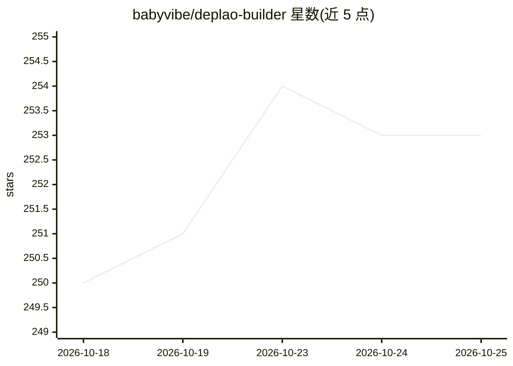

# babyvibe/deplao-builder

⭐ 253 · TypeScript · MIT · 推送 2026-10-20 · [GitHub](https://github.com/babyvibe/deplao-builder) · [官网](https://deplaoapp.com/) · 个人维护

**Zalo/Facebook/Telegram 多账号桌面运营平台：集 CRM、营销、POS、ERP、工作流与 AI 助手**

基于 Electron/React/TypeScript 的桌面应用，面向越南主流聊天渠道 Zalo、Facebook Messenger、Telegram 的多账号集中管理：统一收件箱、历史消息同步、CRM 联系人与标签、批量发信营销活动、拖拽式 workflow 自动化（可由 AI 对话生成流程）、POS/物流/支付集成、内部 ERP 与 Boss-员工多工作区协作。AI 部分为助手功能：回复建议、消息分类、自动应答，通过 9router/OpenRouter 或直连 OpenAI、Claude、Gemini 等网关接入。本地 SQLite 存储，提供近 300 个操作的 Public API、webhook 与插件系统。数据本地优先，未签名安装包可能触发系统警告。

## 筛选速览

| 维度 | 判定 | 备注 |
|---|---|---|
| AI 角色 | `ai-enhanced` | 去掉 AI 部分产品仍成立 |
| 许可风险 | `permissive` | MIT |
| 部署形态 | `desktop` | 安装包/桌面程序 |
| 模型依赖 | locked-api |  |
| 硬件要求 | — | 无带数字的原话,不猜 |
| 安装摩擦 | `low` | 无编译、无系统依赖或容器化 |
| 成熟度 | — | 结构信号不足 |

## 能力要点

- 多账号 Zalo/Facebook/Telegram 统一收件箱与消息历史同步
- 拖拽式 workflow 自动化，支持 AI 对话生成流程
- AI 助手：回复建议、消息分类、24/7 自动应答（9router/OpenRouter/直连多模型）
- Public API v1 约 300 个操作、webhook、插件 SDK 与 Boss-员工多端协作

## 适用场景

- 网店团队集中处理 Zalo/FB/Telegram 多账号私信与订单
- 自动化客户维护与批量营销活动并查看实时统计
- 中小团队多人共享收件箱并分权限协作
- 通过 API/webhook 把聊天渠道接入自有系统或 n8n

## 场景标签

`工作流自动化` `AI 助手` · 领域:效率与自动化

## 证据(README 行号)

> L6: Tích hợp CRM · MARKETING · ERP · POS · Workflow · Trợ lý AI - vận hành tập trung trong một app duy nhất
> L242: - 🤖 **AI Assistant** - hỗ trợ gợi ý câu trả lời, chat trực tiếp trong hội thoại. Còn giúp phân loại tin nhắn, trả 

## 星数曲线

2026-10-18 250 → 2026-10-25 253（+3）

---
*卡片 v1 · prompt 1.4 · 生成 2026-10-22 · 置信度 high · 依据 README sha `2d30f2c08a7f` · [字段定义](../../DATASET.md)*
