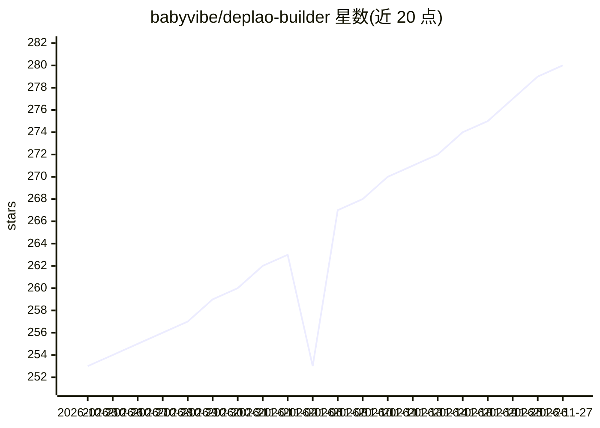

# babyvibe/deplao-builder

⭐ 280 · TypeScript · MIT · 推送 2026-11-21 · [GitHub](https://github.com/babyvibe/deplao-builder) · [官网](https://deplaoapp.com/) · 个人维护

**给电商与销售团队的多账号 Zalo/Facebook/Telegram 桌面运营台**

基于 Electron 的桌面应用，将多个 Zalo、Facebook、Telegram 账号收进统一收件箱，覆盖 CRM、营销活动、工作流自动化、POS/ERP、报表与员工权限管理。AI 部分提供回复建议、聊天内问答、消息分类与 24/7 自动回复，工作流可由 AI copilot 对话生成。数据本地 SQLite 存储，通过 9router/OpenRouter 或直连各模型 API 接入 AI；提供约 300 个操作的 Public API 与插件 SDK。安装包未代码签名，系统首次启动会警告。

## 筛选速览

| 维度 | 判定 | 备注 |
|---|---|---|
| AI 角色 | `ai-enhanced` | 去掉 AI 部分产品仍成立 |
| 许可风险 | `permissive` | MIT |
| 部署形态 | `desktop` | 安装包/桌面程序 |
| 模型依赖 | — | README 未给出锁定关系 |
| 硬件要求 | — | 无带数字的原话,不猜 |
| 安装摩擦 | `low` | 无编译、无系统依赖或容器化 |
| 成熟度 | — | 结构信号不足 |

## 能力要点

- 多账号统一收件箱（Zalo/Facebook/Telegram，无限账号）
- 拖拽式工作流自动化，支持 AI copilot 对话生成流程
- Public API v1 约 300 个操作 + webhooks + 插件 SDK
- 本地 SQLite 存储，可选 Cloudflare R2 / Google Drive 备份

## 适用场景

- 网店销售团队在 Zalo/FB/Telegram 上统一处理客户消息与订单
- 用工作流自动回复和营销活动做客户复购触达
- 多人团队分账号管理收件箱并追踪员工绩效
- 开发者通过 API 和 webhook 把聊天接入自有系统

## 场景标签

`工作流自动化` · 领域:效率与自动化

## 证据(README 行号)

> L5: **Desktop app for managing multiple Zalo, Facebook & Telegram accounts**
> L109: - **AI Gateway:** 9router, OpenRouter or direct OpenAI, Claude, Gemini...
> L240: - 🤖 **AI Assistant** - reply suggestions, in-chat AI Q&A, message classification and 24/7 auto-replies

## 星数曲线

2026-10-25 253 → 2026-11-27 280（+27）

---
*卡片 v1 · prompt 1.4 · 生成 2026-11-25 · 置信度 high · 依据 README sha `c494eec748aa` · [字段定义](../../DATASET.md)*
