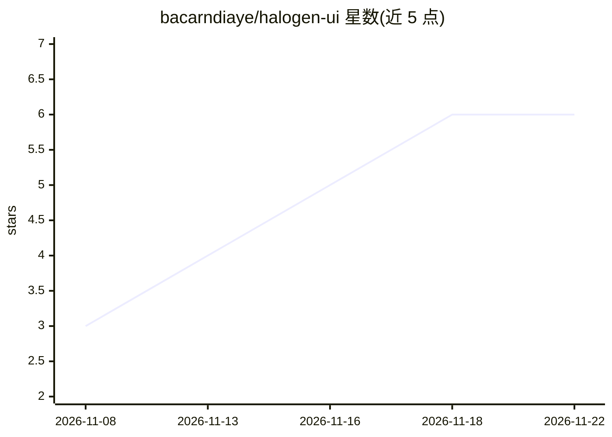

# bacarndiaye/halogen-ui

⭐ 6 · Rust · MIT · 推送 2026-10-16 · [GitHub](https://github.com/bacarndiaye/halogen-ui) · 个人维护

**Halogen 推理服务器的实时 Web 监控面板**

面向运行 Halogen 推理服务器的运维者，提供只读的实时监控页面：每请求解码/预填充速度、上下文占用、KV 池、prompt 缓存命中、GPU 负载/显存/温度/功耗及最近请求列表，页面每秒刷新两次。以单个静态 Rust 二进制分发，无外部依赖。可选用 --chat 开启浏览器聊天页（中继到 /v1/chat/completions，流式输出、图片与文件附件），并可开启透明 TCP 代理为所有客户端统计实时 token。默认不读取任何提示词或回答文本。

## 筛选速览

| 维度 | 判定 | 备注 |
|---|---|---|
| AI 角色 | `ai-ecosystem` | LLM/agent 周边工具 |
| 许可风险 | `permissive` | MIT |
| 部署形态 | `None` |  |
| 模型依赖 | — | README 未给出锁定关系 |
| 硬件要求 | — | 无带数字的原话,不猜 |
| 安装摩擦 | `medium` | 含编译或系统依赖之一 |
| 成熟度 | — | 结构信号不足 |

## 能力要点

- 单个静态 Rust 二进制，无依赖，只读监控可公开分享
- 读取 amdgpu sysfs 或 nvidia-smi 展示 GPU 负载/显存/温度/功耗
- 可选聊天页：流式 Markdown 输出、thinking 折叠、图片/文本附件
- 透明 TCP 代理监听 SSE 流，为所有客户端提供实时 token 计数

## 适用场景

- 在自己的服务器上实时查看 Halogen 推理速度与 GPU 状态
- 与团队共享只读监控页面而不暴露提示词内容
- 在可信内网中通过浏览器直接与模型对话

## 场景标签

`LLM 可观测性` · 领域:评测与运维

## 证据(README 行号)

> L3: A live web monitor for a Halogen inference server: speed per
> L7: One small static binary written in Rust, **no dependencies**. The monitor is read-only; an optional chat page

## 星数曲线

2026-11-08 3 → 2026-11-22 6（+3）

---
*卡片 v1 · prompt 1.4 · 生成 2026-11-20 · 置信度 high · 依据 README sha `56dbc037e422` · [字段定义](../../DATASET.md)*
