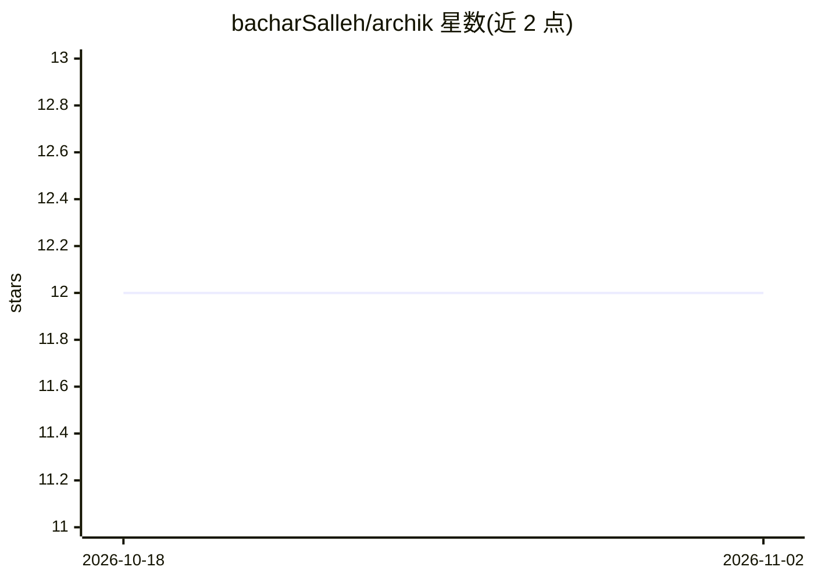

# bacharSalleh/archik

⭐ 12 · TypeScript · MIT · 推送 2026-10-18 · [GitHub](https://github.com/bacharSalleh/archik) · [官网](https://www.npmjs.com/package/archik) · 个人维护

**YAML 架构图即代码工具：CI 校验、浏览器渲染、供 AI 编辑器读取**

以纯 YAML 为架构图唯一事实来源的开发者工具：CLI 脚手架生成 `.archik` 文件，validator 在合并前拒绝漂移（schema + 跨文件完整性 + 治理约束），浏览器实时画布由 ELK 计算布局，无坐标存储。drift/smells/otel check 命令核验图与代码及生产流量的一致性；AI 部分：安装 Claude Code skill 与斜杠命令，并运行 MCP 服务器让任意 agent 通过 CLI 读写架构，用户在画布上批准每次结构变更。含决策记录、docker-compose/Mermaid 导入、GitHub Action 与 pre-commit 钩子。MIT 协议，需 Node.js ≥ 20。

## 筛选速览

| 维度 | 判定 | 备注 |
|---|---|---|
| AI 角色 | `ai-enhanced` | 去掉 AI 部分产品仍成立 |
| 许可风险 | `permissive` | MIT |
| 部署形态 | `library` | 以包/库形式分发 |
| 模型依赖 | locked-api |  |
| 硬件要求 | — | 无带数字的原话,不猜 |
| 安装摩擦 | `low` | 无编译、无系统依赖或容器化 |
| 成熟度 | — | 结构信号不足 |

## 能力要点

- YAML 为唯一事实来源，validator 拒绝漂移，画布为无状态投影
- drift/smells/affected/otel check 核验图与代码及生产依赖一致
- Claude Code skill + `/archik:*` 命令与 stdio MCP 服务器供任意 agent 读写
- docker-compose/Mermaid 导入、语义合并驱动、GitHub Action CI 集成

## 适用场景

- 多组件项目的架构图维护与 CI 漂移拦截
- 让 Claude Code 等 AI agent 基于架构图推理代码结构
- 从现有 docker-compose 或 Mermaid 图迁移出可校验的架构模型

## 场景标签

 · 领域:软件开发/架构文档工具

## 证据(README 行号)

> L18: Your architecture lives in **plain YAML**. You edit it through a **CLI**, a **validator** rejects drift before it m
> L199: Reach for archik when a project has more than a handful of components, ships with an AI agent you want reasoning a

## 星数曲线

2026-10-18 12 → 2026-11-02 12（+0）

---
*卡片 v1 · prompt 1.4 · 生成 2026-11-01 · 置信度 high · 依据 README sha `12db605204a7` · [字段定义](../../DATASET.md)*
