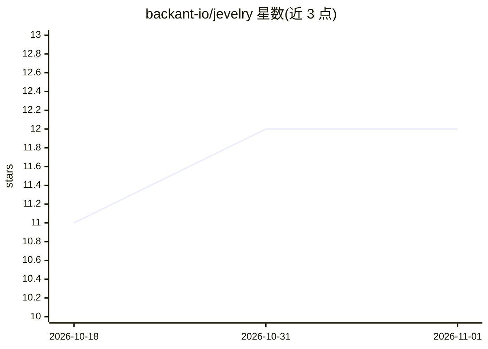

# backant-io/jevelry

⭐ 12 · TypeScript · MIT · 推送 2026-10-20 · [GitHub](https://github.com/backant-io/jevelry) · 组织维护

**让代码与编程 Agent 调用 Jev 决策模型并追踪决策对错的 CLI 库**

jevelry 以 CLI、TUI 与 npm 库形式提供：把『工单是否紧急、该分给哪个团队』等小决策写成 jevel 文件，向 TypeSafe 托管的 Jev 决策模型或本机 Jev 兼容模型提问，返回带置信度的 act/mark/fall_back 三态决策，并持久化记录每次决策供事后复核与阈值调优。本地模式按机器内存列出可运行模型，经 llama.cpp 的 llama-server 提供服务，状态不出本机。限制：早期开发，1.0 前格式可能变动；本地模型需下载 1-30 GB。面向开发者和编程 Agent（Claude Code/Codex/Cursor/opencode/pi）。

## 筛选速览

| 维度 | 判定 | 备注 |
|---|---|---|
| AI 角色 | `ai-native` | 本体是模型或模型工具 |
| 许可风险 | `permissive` | MIT |
| 部署形态 | `library` | 以包/库形式分发 |
| 模型依赖 | — | README 未给出锁定关系 |
| 硬件要求 | — | 无带数字的原话,不猜 |
| 安装摩擦 | `low` | 无编译、无系统依赖或容器化 |
| 成熟度 | `idea` | |

## 能力要点

- 17 个内置 jevel 覆盖工单、issue、PR、日志、告警、失败测试等决策
- act/mark/fall_back 三态决策，附带置信度，可由人工复核并调阈值
- 本地模式：按机器内存排名可选模型，经 llama.cpp llama-server 运行，无 key 且状态留本机
- 一次安装为 Claude Code、Codex、Cursor、opencode、pi 装入 agent skill

## 适用场景

- 把工单分派、紧急度判断等重复小决策交给决策模型并留痕追踪
- 让编程 Agent 编写 jevel 并把决策接入项目代码
- 在本机离线运行 Jev 兼容决策模型，不外发数据

## 场景标签

`Agent 框架` · 领域:Agent 开发

## 证据(README 行号)

> L25: jevelry lets your code and your coding agent ask Jev, the decision model from TypeSafe, a small typed question and 
> L31: With jevelry you ask each of those questions to Jev with one command. A question lives in a small file called a jev

## 星数曲线

2026-10-18 11 → 2026-11-01 12（+1）

---
*卡片 v1 · prompt 1.4 · 生成 2026-11-01 · 置信度 high · 依据 README sha `a9d6af6ca456` · [字段定义](../../DATASET.md)*
