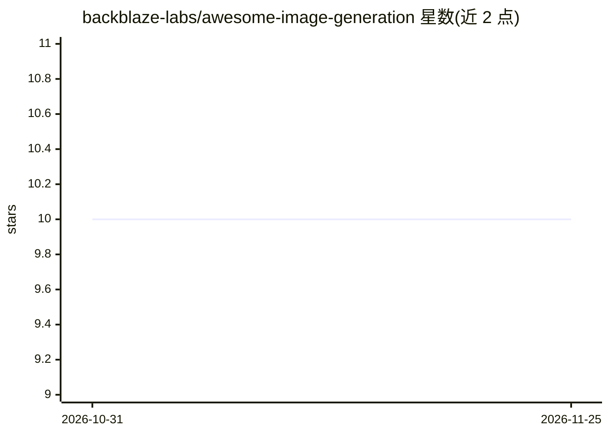

# backblaze-labs/awesome-image-generation

⭐ 10 · CC0-1.0 · 推送 2026-11-20 · [GitHub](https://github.com/backblaze-labs/awesome-image-generation) · [官网](https://blze.ai/storage) · 组织维护

**面向开发者的 AI 图像生成 API、模型与工具清单**

由 Backblaze 维护的策展清单，收录 AI 图像生成相关的商业 API、开源模型与框架工具。内容按文本生成图像 API、可本地运行的开源权重模型、开源框架与 UI（如 ComfyUI、训练工具）等类别组织；每个条目附服务简介、文档链接与 SDK 语言信息，覆盖推理托管平台、图像编辑、LoRA 训练与工作流部署等环节。许可为 CC0-1.0。

## 筛选速览

| 维度 | 判定 | 备注 |
|---|---|---|
| AI 角色 | `ai-knowledge` | 知识聚合/清单类 |
| 许可风险 | `viral` | CC0-1.0 |
| 部署形态 | `library` | 以包/库形式分发 |
| 模型依赖 | — | README 未给出锁定关系 |
| 硬件要求 | — | 无带数字的原话,不猜 |
| 安装摩擦 | `medium` | 含编译或系统依赖之一 |
| 成熟度 | — | 结构信号不足 |

## 能力要点

- 收录 20+ 家文本生成图像商业 API 及其 SDK 信息
- 整理 20+ 个可本地/自托管的开源图像生成模型
- 覆盖 LoRA 训练、工作流打包部署等配套工具条目
- 每个条目附文档与 SDK 语言说明

## 适用场景

- 为应用选型图像生成 API 时对比各家服务与 SDK
- 寻找可本地部署的开源文生图模型
- 查找 ComfyUI 生态的部署、管理与训练工具
- 了解图像生成领域的服务与模型全景

## 场景标签

`图像生成` `精选清单` · 领域:内容生成

## 证据(README 行号)

> L5: A curated list of AI image generation APIs, SDKs, and production-ready tools. Focused on services developers can int
> L7: Maintained by Backblaze.
> L20: ## Text-to-Image APIs

## 星数曲线

2026-10-31 10 → 2026-11-25 10（+0）

---
*卡片 v1 · prompt 1.4 · 生成 2026-11-19 · 置信度 mid · 依据 README sha `a13ae9fd7972` · [字段定义](../../DATASET.md)*
