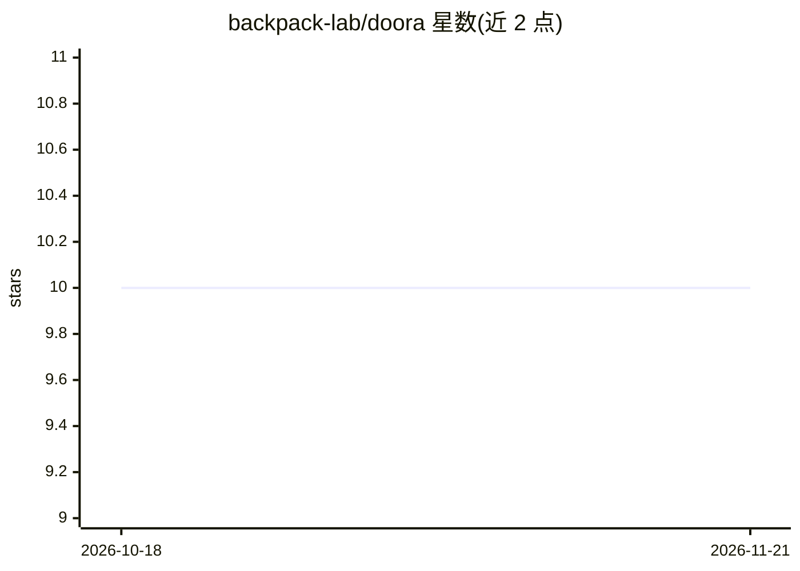

# backpack-lab/doora

⭐ 10 · Rust · Apache-2.0 · 推送 2026-05-26 · [GitHub](https://github.com/backpack-lab/doora) · [官网](https://backpack-lab.github.io/maps/) · 组织维护

**给开发者与 AI 编码代理的结构化代码搜索引擎**

基于 Tree-sitter 的 CLI 工具：把源码解析为 AST，用 S-表达式查询定位函数定义、类型、调用点等文本搜索无法区分的结构关系，支持 Rust、Python、JS、TS、Go、C、C++ 七种语言。内置 Bloom 过滤预筛、SQLite 持久符号索引、语义重写与交互式 TUI。通过 MCP 服务器（JSON-RPC stdio）把结构索引暴露给 LLM 编码代理，使代理直接执行精确查询而非读入原始源码。安装途径包括 crates.io、预编译二进制与源码构建。

## 筛选速览

| 维度 | 判定 | 备注 |
|---|---|---|
| AI 角色 | `ai-ecosystem` | LLM/agent 周边工具 |
| 许可风险 | `permissive` | Apache-2.0 |
| 部署形态 | `desktop` | 安装包/桌面程序 |
| 模型依赖 | — | README 未给出锁定关系 |
| 硬件要求 | — | 无带数字的原话,不猜 |
| 安装摩擦 | `medium` | 含编译或系统依赖之一 |
| 成熟度 | — | 结构信号不足 |

## 能力要点

- Tree-sitter S-表达式结构查询，支持 7 种语言与自动语言检测
- Bloom 过滤预拒索引与 Rayon 并行解析
- SQLite 持久符号索引（lookup 按名称/前缀/kind 查询）
- MCP 服务器模式将代码结构图暴露给 LLM 编码代理

## 适用场景

- 在大型仓库中精确定位函数定义、trait 实现等结构关系
- 让 AI 编码代理通过 MCP 执行精确代码查询以减少上下文消耗
- 基于 AST 的语义批量重写（定义站点重命名等）
- 跨混合语言仓库统一执行结构搜索

## 场景标签

 · 领域:开发者工具/代码搜索

## 证据(README 行号)

> L11: `doora` is a high-performance structural code search engine built on Tree-sitter. It parses source files into `Abst
> L13: Additionally, `doora` serves as a persistent "Codebase Memory" for AI coding agents. By exposing its structural ind
> L52: - **MCP server** — expose your codebase's structural graph to LLM coding agents
> L242: ### serve --mcp command

## 星数曲线

2026-10-18 10 → 2026-11-21 10（+0）

---
*卡片 v1 · prompt 1.4 · 生成 2026-11-19 · 置信度 high · 依据 README sha `283d409762f0` · [字段定义](../../DATASET.md)*
