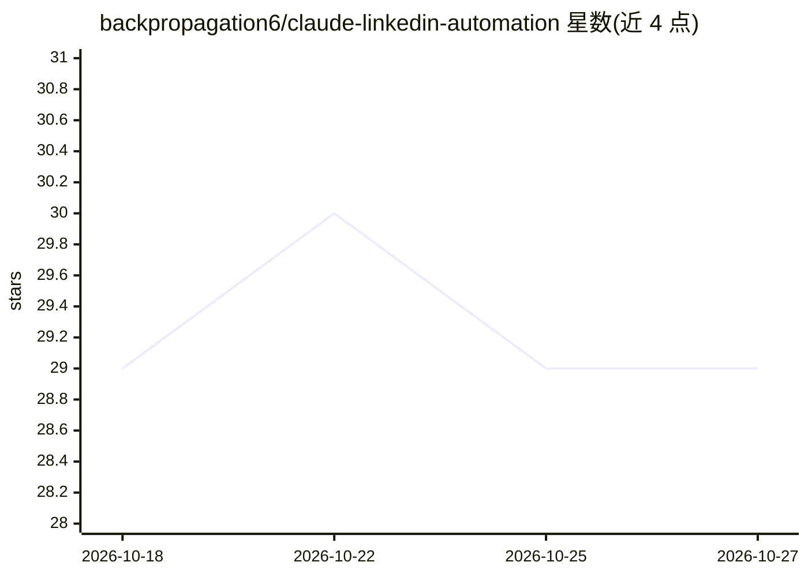

# backpropagation6/claude-linkedin-automation

⭐ 29 · Shell · MIT · 推送 2026-04-07 · [GitHub](https://github.com/backpropagation6/claude-linkedin-automation) · [官网](https://giovanniliguori.it) · 个人维护

**让 Claude 自主运营 LinkedIn 主页的 agent 技能（含反检测体系）**

面向 Claude Code/Cowork/Cursor/Windsurf 的自定义技能（SKILL.md 形式）：通过 `/linkedin` 五阶段向导采集用户身份、语气与策略，部署 10 个定时任务（每日发帖、互动、DM 草稿、周报等）实现 LinkedIn 账号的自主运营。内含两级反检测体系（7 条行为规则+结构自然化层）、Non-Detection Index 评分与发布前事实核验门。README 附法律声明：自动化互动可能违反 LinkedIn 用户协议。安装为 git clone 后运行 install.sh，Phase 4 设有人工审批硬门禁。

## 筛选速览

| 维度 | 判定 | 备注 |
|---|---|---|
| AI 角色 | `ai-native` | 本体是模型或模型工具 |
| 许可风险 | `permissive` | MIT |
| 部署形态 | `None` |  |
| 模型依赖 | locked-api |  |
| 硬件要求 | — | 无带数字的原话,不猜 |
| 安装摩擦 | `low` | 无编译、无系统依赖或容器化 |
| 成熟度 | — | 结构信号不足 |

## 能力要点

- 五阶段向导采集身份/策略，Phase 4 人工审批后才自动化
- 10 个定时任务（发帖/互动/DM 草稿/审计/周报）
- 两级反检测：行为规则 + 结构自然化（7 种结构性 AI 痕迹修正）
- NDI 评分公式与 7 项发布前事实核验检查点

## 适用场景

- 用 Claude 定时生成并发布 LinkedIn 内容与互动
- 为个人品牌账号生成一周发帖计划并按日历执行
- 对已发布内容做自然度评分与检测风险审计

## 场景标签

`AI 写作` `工作流自动化` · 领域:效率与自动化

## 证据(README 行号)

> L28: A **custom skill for Claude** that turns your AI assistant into a full-stack LinkedIn manager. It posts daily, enga
> L81: ├── SKILL.md                              # The skill itself (5-phase wizard)

## 星数曲线

2026-10-18 29 → 2026-10-27 29（+0）

---
*卡片 v1 · prompt 1.4 · 生成 2026-10-26 · 置信度 high · 依据 README sha `10263e0fb682` · [字段定义](../../DATASET.md)*
