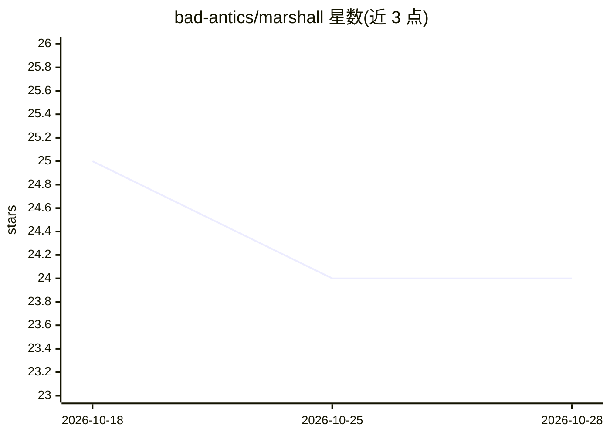

# bad-antics/marshall

⭐ 24 · Rust · MIT · 推送 2026-02-22 · [GitHub](https://github.com/bad-antics/marshall) · [官网](https://github.com/bad-antics/marshall#-features) · 个人维护

**面向隐私与安全研究者的 Rust+GTK 浏览器，内置 AI 助手侧栏**

以 Rust+GTK3 编写、WebKitGTK 渲染的桌面隐私浏览器，功能包括内置广告拦截、Tor 集成、标签隔离、反指纹、DNS over HTTPS、退出时清除数据，以及面向安全研究的 OSINT 工具集（IP/WHOIS/DNS 查询、SSL 分析、技术栈检测等，通过右键菜单与快捷键触发），并带 AI 助手侧栏。不支持 Chrome/Firefox 扩展，使用自有扩展格式；需从源码用 cargo 编译运行，依赖 GTK 3.0 与 WebKitGTK。威胁模型声明不应对国家级对手与零日漏洞。

## 筛选速览

| 维度 | 判定 | 备注 |
|---|---|---|
| AI 角色 | `ai-enhanced` | 去掉 AI 部分产品仍成立 |
| 许可风险 | `permissive` | MIT |
| 部署形态 | `None` |  |
| 模型依赖 | — | README 未给出锁定关系 |
| 硬件要求 | — | 无带数字的原话,不猜 |
| 安装摩擦 | `medium` | 含编译或系统依赖之一 |
| 成熟度 | — | 结构信号不足 |

## 能力要点

- Tor 集成（--tor 启动）与 DNS over HTTPS + DNSSEC
- 右键菜单与内置 OSINT 工具（Shodan/WHOIS/VirusTotal 等）
- Canvas/WebGL/Audio API 反指纹与 WebRTC 泄漏防护
- AI 助手侧栏（README 未展开细节）

## 适用场景

- 日常匿名浏览与防跟踪
- 安全研究员在浏览网页时直接做 IP/域名/证书侦察
- 需要退出自动清除数据的敏感环境上网

## 场景标签

`AI 助手` `网络安全` · 领域:对话与助手

## 证据(README 行号)

> L7: > Privacy-focused web browser built with Rust + GTK3
> L13: - 🤖 AI Assistant sidebar

## 星数曲线

2026-10-18 25 → 2026-10-28 24（-1）

---
*卡片 v1 · prompt 1.4 · 生成 2026-10-27 · 置信度 high · 依据 README sha `bd2dded8ad04` · [字段定义](../../DATASET.md)*
