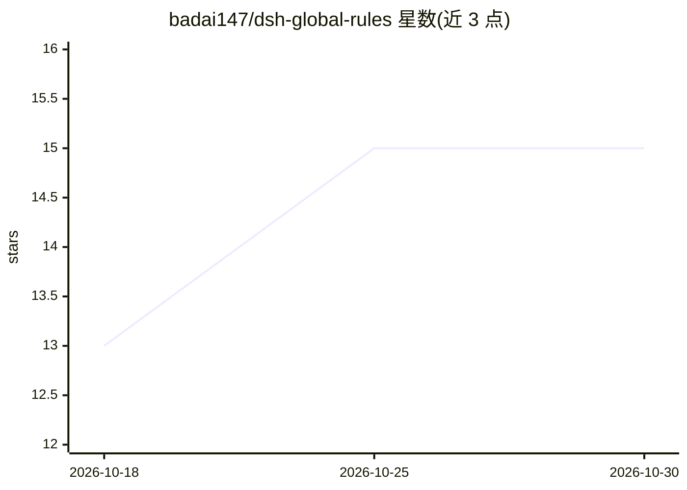

# badai147/dsh-global-rules

⭐ 15 · JavaScript · MIT · 推送 2026-10-17 · [GitHub](https://github.com/badai147/dsh-global-rules) · 个人维护 · 中文 README

**在 DeepSeek Harness Web 面板中编辑全局规则文件的插件**

面向 DeepSeek Harness（dsh）web 配置的插件：在设置面板新增「全局规则」标签页，读取并编辑用户全局规则文件 $DSH_HOME/AGENTS.md（默认 ~/.dsh/AGENTS.md），保存立即生效——新会话第一步即读取新规则，当前会话在下一次文件操作后由内置 dsh-agent-instructions 变更检测注入。路径解析规则与 harness 本体一致（非空 $DSH_HOME 优先）。客户端为零构建的手写 __ModuleLoader__ bundle，宿主侧为 Node ESM，通过 GET/POST /api/global-rules 路由读写文件（256 KiB 限制）。安装方式为 dsh plugin --profile web add 命令，无额外运行时依赖。

## 筛选速览

| 维度 | 判定 | 备注 |
|---|---|---|
| AI 角色 | `ai-ecosystem` | LLM/agent 周边工具 |
| 许可风险 | `permissive` | MIT |
| 部署形态 | `None` |  |
| 模型依赖 | locked-api |  |
| 硬件要求 | — | 无带数字的原话,不猜 |
| 安装摩擦 | `low` | 无编译、无系统依赖或容器化 |
| 成熟度 | — | 结构信号不足 |

## 能力要点

- 在 Web 设置面板新增「全局规则」标签页，读写 AGENTS.md
- 保存即时生效：新会话立即读取，当前会话由变更检测注入
- 路径解析与 harness 内置规则一致（$DSH_HOME 优先于 ~/.dsh）
- 零构建：手写 __ModuleLoader__ 客户端 bundle + Node ESM 宿主，无额外依赖

## 适用场景

- 不想切终端、直接在 Web 面板里改 agent 全局规则
- 团队统一维护 DSH 的 AGENTS.md 指令文件
- 保存后立即让新会话应用更新的规则

## 场景标签

`提示工程` · 领域:Agent 开发

## 证据(README 行号)

> L7: Edit your user-global rules file `$DSH_HOME/AGENTS.md` (default `~/.dsh/AGENTS.md`) from the DeepSeek Harness web se
> L21: - DeepSeek Harness (`dsh`) with the `web` profile

## 星数曲线

2026-10-18 13 → 2026-10-30 15（+2）

---
*卡片 v1 · prompt 1.4 · 生成 2026-10-30 · 置信度 high · 依据 README sha `abf6881a2520` · [字段定义](../../DATASET.md)*
