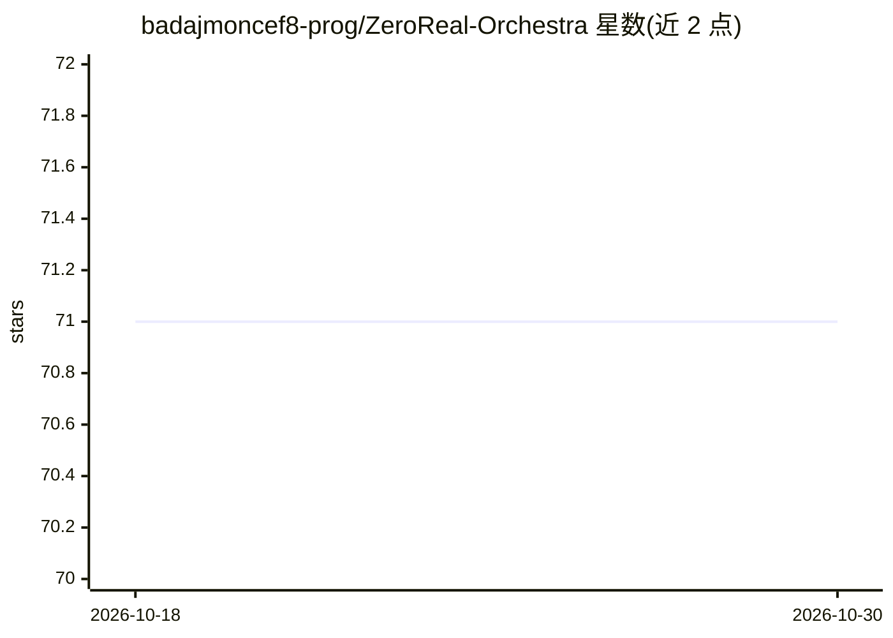

# badajmoncef8-prog/ZeroReal-Orchestra

⭐ 71 · HTML · 推送 2026-10-29 · [GitHub](https://github.com/badajmoncef8-prog/ZeroReal-Orchestra) · 个人维护

**将浏览器端 ChatGPT/DeepSeek/Gemini 回答转译为本地自动执行的桥接工具**

面向希望在不使用付费 API key 的前提下调用网页版 AI（ChatGPT、DeepSeek、Gemini 等）的用户：通过浏览器扩展或面板捕获 AI 文本回答，经启发式/正则与辅助模型解析为结构化意图，再交由本地执行器完成文件整理、报告生成、数据处理、提醒等任务。架构分四层（捕获/解释/桥接/执行），桥接层本地运行并记录活动日志，支持插件扩展与多语言界面。README 自述为概念性与实验性项目，路线图将稳定版排至 2026 年。

## 筛选速览

| 维度 | 判定 | 备注 |
|---|---|---|
| AI 角色 | `ai-ecosystem` | LLM/agent 周边工具 |
| 许可风险 | `none` | — |
| 部署形态 | `None` |  |
| 模型依赖 | — | README 未给出锁定关系 |
| 硬件要求 | — | 无带数字的原话,不猜 |
| 安装摩擦 | `low` | 无编译、无系统依赖或容器化 |
| 成熟度 | `idea` | |

## 能力要点

- 无需 API key 即可接入网页版 AI 平台（ChatGPT/DeepSeek/Gemini）
- 自然语言回答→结构化意图→本地执行器（Real）的四层桥接架构
- 本地运行桥接层，附活动日志与操作确认机制
- 插件机制扩展新执行器与解释器，界面支持四种语言

## 适用场景

- 让网页版 AI 直接帮我整理本地文件、生成报告
- 日常重复性任务通过对话触发本地自动执行
- 研究人员用 AI 收集与总结信息并在本地落地结果

## 场景标签

`工作流自动化` `AI 助手` · 领域:效率与自动化

## 证据(README 行号)

> L20: Essa ponte é o coração do projeto. Ela interpreta instruções em linguagem natural, converte-as em ações estruturada
> L36: 1. **Camada de Captura (Capture Layer)** — Responsável por interagir com a interface web da IA escolhida. Pode oper

## 星数曲线

2026-10-18 71 → 2026-10-30 71（+0）

---
*卡片 v1 · prompt 1.4 · 生成 2026-10-24 · 置信度 mid · 依据 README sha `748b6cadca86` · [字段定义](../../DATASET.md)*
