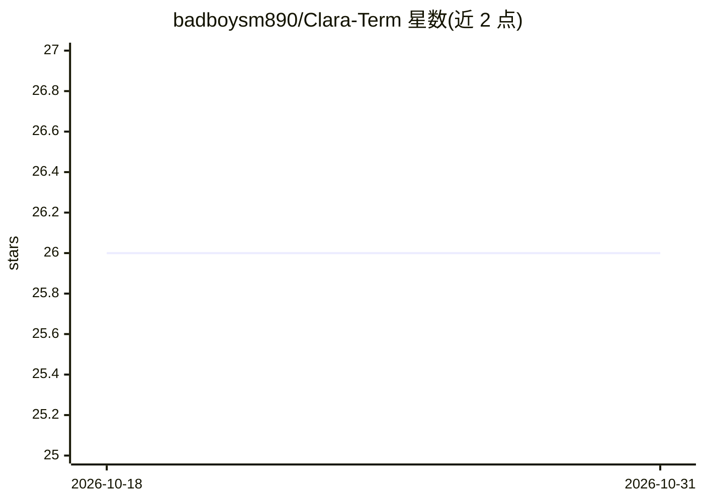

# badboysm890/Clara-Term

⭐ 26 · Python · MIT · 推送 2026-01-31 · [GitHub](https://github.com/badboysm890/Clara-Term) · 个人维护

**面向开发者的 GPT 驱动终端脚本自动化工具**

ClaraTerm 是一个用 Python 编写的终端自动化工具，调用 GPT（当前 GPT-3.5）实现脚本生成、自动纠错与依赖管理辅助；提供 Python 支持，Go 与 JavaScript 扩展处于计划中，并计划接入 GUVI-GPT 与 Llama2。使用方式为命令行 clara -i 传入查询；安装通过创建虚拟环境后 pip install --editable . 从源码安装。README 未展示具体的 API 配置流程细节，项目同时宣称为未来 AI 操作系统打基础。

## 筛选速览

| 维度 | 判定 | 备注 |
|---|---|---|
| AI 角色 | `ai-native` | 本体是模型或模型工具 |
| 许可风险 | `permissive` | MIT |
| 部署形态 | `library` | 以包/库形式分发 |
| 模型依赖 | — | README 未给出锁定关系 |
| 硬件要求 | — | 无带数字的原话,不猜 |
| 安装摩擦 | `low` | 无编译、无系统依赖或容器化 |
| 成熟度 | `idea` | |

## 能力要点

- 调用 GPT 的命令行脚本自动化与自动纠错
- Python 语言支持，Go/JavaScript 为计划扩展
- 计划兼容 GUVI-GPT 与 Llama2

## 适用场景

- 在终端用自然语言生成与修正脚本
- 借助 AI 辅助管理项目依赖
- 作为本地终端自动化入口进行日常系统操作

## 场景标签

`代码生成` · 领域:编码与开发

## 证据(README 行号)

> L15: ClaraTerm is an advanced terminal automation tool, integrating cutting-edge AI technology, specifically GPT, settin
> L19: - **GPT-Enhanced Script Automation**: Utilizing GPT for superior scripting efficiency and intelligence.

## 星数曲线

2026-10-18 26 → 2026-10-31 26（+0）

---
*卡片 v1 · prompt 1.4 · 生成 2026-10-26 · 置信度 mid · 依据 README sha `0ed29b5ca5e8` · [字段定义](../../DATASET.md)*
