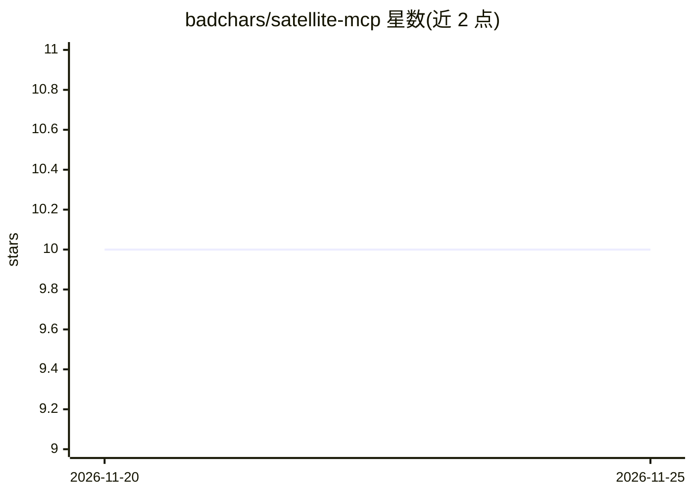

# badchars/satellite-mcp

⭐ 10 · TypeScript · MIT · 推送 2026-09-01 · [GitHub](https://github.com/badchars/satellite-mcp) · [官网](https://www.npmjs.com/package/satellite-mcp) · 个人维护

**面向 AI 客户端的开源地理空间情报 MCP 服务器（171 工具）**

基于 Model Context Protocol 的地理空间情报（GEOINT）服务器，提供 27 个类别共 171 个工具：卫星影像检索、ADS-B 飞机追踪、AIS 船舶监控、军事设施查询、冲突事件监测、环境分析等，数据来自 Sentinel-2、Landsat、NASA FIRMS、OpenSky、Global Fishing Watch、ACLED 等开放数据源。多数工具零配置可用，API key 可选；仅依赖 @modelcontextprotocol/sdk 与 zod，经 stdio 传输接入 Claude Desktop、Claude Code、Cursor 等 MCP 客户端，也可通过 CLI 直接调用单个工具。

## 筛选速览

| 维度 | 判定 | 备注 |
|---|---|---|
| AI 角色 | `ai-ecosystem` | LLM/agent 周边工具 |
| 许可风险 | `permissive` | MIT |
| 部署形态 | `library` | 以包/库形式分发 |
| 模型依赖 | — | README 未给出锁定关系 |
| 硬件要求 | — | 无带数字的原话,不猜 |
| 安装摩擦 | `low` | 无编译、无系统依赖或容器化 |
| 成熟度 | — | 结构信号不足 |

## 能力要点

- 171 个工具覆盖 27 个 GEOINT 类别，数据源均为开放数据
- 多数工具零配置可用，API key 可选解锁更多数据源
- 运行时依赖仅 @modelcontextprotocol/sdk 与 zod 两个
- 支持 stdio 传输，可接入任意 MCP 兼容客户端，另提供 CLI 直接调用

## 适用场景

- 通过对话式 AI 客户端查询卫星影像与火点、地震等监测数据
- 追踪飞机与船舶轨迹、检测军事活动与异常行为
- 用 NDVI 等光谱指数做多时相变化检测分析

## 场景标签

 · 领域:地理空间/GIS 工具

## 证据(README 行号)

> L19: Full-spectrum GEOINT (Geospatial Intelligence) server for the Model Context Protocol. 171 tools covering satellite 
> L32: - **Stdio transport** &mdash; works with Claude Desktop, Claude Code, Cursor, Windsurf, and any MCP-compatible clie

## 星数曲线

2026-11-20 10 → 2026-11-25 10（+0）

---
*卡片 v1 · prompt 1.4 · 生成 2026-11-20 · 置信度 high · 依据 README sha `a4d505a277cb` · [字段定义](../../DATASET.md)*
