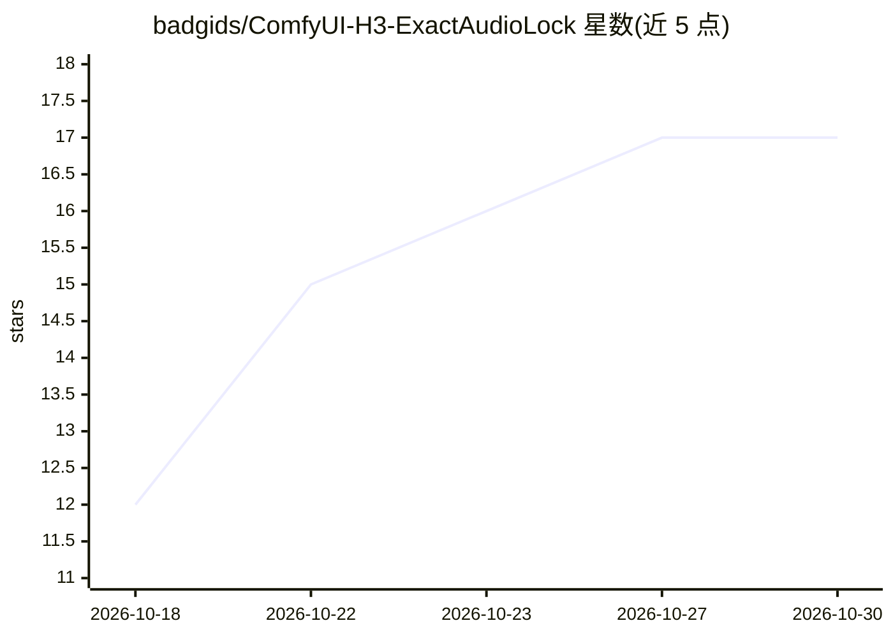

# badgids/ComfyUI-H3-ExactAudioLock

⭐ 17 · Python · MIT · 推送 2026-09-28 · [GitHub](https://github.com/badgids/ComfyUI-H3-ExactAudioLock) · 个人维护

**ComfyUI 自定义节点包：为 MiniMax H3 锁定精确目标音频**

面向 MiniMax H3 视频/音频联合生成的 ComfyUI 自定义节点包：将用户提供的多路音频（对白、歌唱、音乐等）按帧级时间线确定性混音，编码后替换 H3 的目标音频 latent 并在去噪过程中锁定，同时保持视频部分可去噪；支持仅锁定对白区间的部分锁定与采样后精确还原，并提供人工 Audio Review / Accept Gate 从候选中选定一条送入后续工作流。需在已支持 MiniMax H3 的 ComfyUI 环境（Python 3.11+、PyTorch/TorchAudio、PyAV 14.2.0+）中通过 git clone 安装。

## 筛选速览

| 维度 | 判定 | 备注 |
|---|---|---|
| AI 角色 | `ai-ecosystem` | LLM/agent 周边工具 |
| 许可风险 | `permissive` | MIT |
| 部署形态 | `desktop` | 安装包/桌面程序 |
| 模型依赖 | — | README 未给出锁定关系 |
| 硬件要求 | — | 无带数字的原话,不猜 |
| 安装摩擦 | `medium` | 含编译或系统依赖之一 |
| 成熟度 | — | 结构信号不足 |

## 能力要点

- 将精确用户波形锁定进 MiniMax H3 目标音频 latent，视频仍可去噪
- 最多 100 个定时音频事件、确定性整数帧-采样转换与逐源增益
- 仅对白区间部分锁定，H3 可继续生成环境声/Foley/音乐
- 人工 Audio Review / Accept Gate 审核候选并仅输出选定结果

## 适用场景

- 多说话人对白/重叠语音场景中让 H3 画面精确响应我提供的音频
- 歌唱、MV 制作中锁定音轨后由 H3 生成画面
- 递归 H3 Director/Context Loop 工作流中做场景感知的音频锁定

## 场景标签

`视频生成` · 领域:内容生成

## 证据(README 行号)

> L7: ComfyUI-H3-ExactAudioLock is a ComfyUI custom-node package for MiniMax H3 that builds deterministic, sample-accurate
> L18: - A current ComfyUI installation with MiniMax H3 support.

## 星数曲线

2026-10-18 12 → 2026-10-30 17（+5）

---
*卡片 v1 · prompt 1.4 · 生成 2026-10-29 · 置信度 mid · 依据 README sha `df255c8fcfcf` · [字段定义](../../DATASET.md)*
