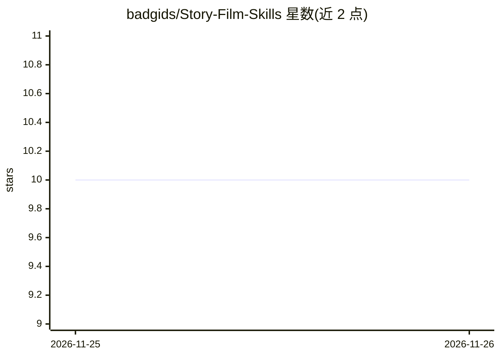

# badgids/Story-Film-Skills

⭐ 10 · Python · Apache-2.0 · 推送 2026-08-24 · [GitHub](https://github.com/badgids/Story-Film-Skills) · 个人维护

**面向 AI agent 的本地故事与电影全流程制作技能套件**

以 Agent Skills 形式提供的本地优先制作套件，覆盖从创意访谈、小说/剧本写作到分镜、ComfyUI 图像/音频/视频生成、剪辑交付的完整链路。通过持久化项目文件、稳定 ID（SCN-/SHOT- 等）、确定性校验器和可恢复检查点管理长片制作，提供序列生产、上下文分片、生成预算与完成度审计等九项长片控制机制，支持本地 LLM 与生成模型按 RAM/VRAM 限额分时运行。

## 筛选速览

| 维度 | 判定 | 备注 |
|---|---|---|
| AI 角色 | `ai-native` | 本体是模型或模型工具 |
| 许可风险 | `permissive` | Apache-2.0 |
| 部署形态 | `library` | 以包/库形式分发 |
| 模型依赖 | local-ok | 支持本地模型 |
| 硬件要求 | — | 无带数字的原话,不猜 |
| 安装摩擦 | `low` | 无编译、无系统依赖或容器化 |
| 成熟度 | `idea` | |

## 能力要点

- SCN-/LINE-/SHOT-/TAKE- 稳定 ID 与确定性校验器支撑长片连续性
- 工作流优先的 ComfyUI 选择：编号目录 + 用户自定义工作流目录
- 本地 LLM 与 ComfyUI 模型的内存交接：卸载 LLM 后离线执行批处理再恢复
- 完成度审计与九项长片生产控制（序列、检查点、部分批恢复等）

## 适用场景

- 用 AI agent 从一个故事点子推进到 90 分钟以上长片的交付包
- 本地显存无法同时容纳 LLM 与生成模型时分阶段执行生成任务
- 按生产文档、分镜表与 QC 清单管理影视项目的制作流程

## 场景标签

`工作流自动化` `AI 写作` `图像生成` `视频生成` · 领域:效率与自动化

## 证据(README 行号)

> L7: Story-Film Skills is a local-first Agent Skills suite for story writing, book development, screenwriting, image/audi
> L34: - ComfyUI workflow validation, reference-binding audits, reusable workflow contracts, and complete built-in editabl
> L36: - workflow-first generation using numbered choices only from the extension's `comfyui_workflows/` library: bundled 

## 星数曲线

2026-11-25 10 → 2026-11-26 10（+0）

---
*卡片 v1 · prompt 1.4 · 生成 2026-11-24 · 置信度 mid · 依据 README sha `a8de7c5312f0` · [字段定义](../../DATASET.md)*
