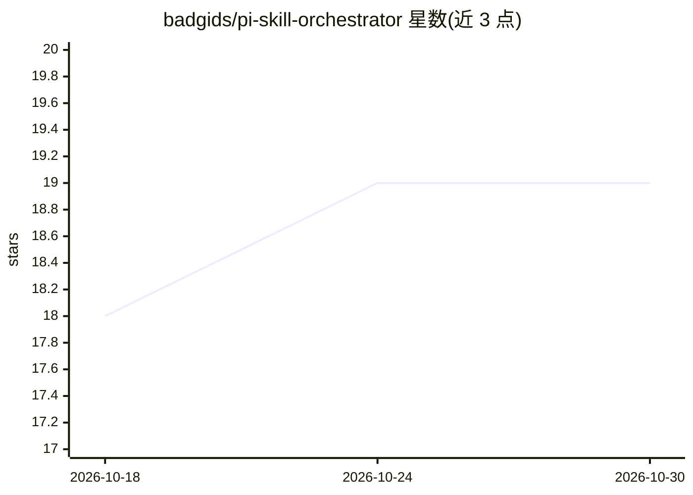

# badgids/pi-skill-orchestrator

⭐ 19 · TypeScript · MIT · 推送 2026-09-18 · [GitHub](https://github.com/badgids/pi-skill-orchestrator) · 个人维护

**Pi 终端的 Agent 技能懒加载扩展：技能目录不占系统提示词**

面向 Pi（终端 AI 编码工具）用户的社区扩展，用于管理大量 Agent Skills。机制：在每轮模型调用前移除 Pi 原生的完整技能目录，替换为小的 scope 指令；模型需要能力时才搜索技能元数据并按需加载单个技能及其递归依赖。支持技能分组与可复用 profile 切换搜索范围，带边界全局回退搜索；保留 Pi 的 /skill: 自动补全。可选 Token Saver（默认关闭）对大体积工具输出做内容感知压缩，原始输出保留在会话内恢复缓存中，重启后不可恢复。要求 Node.js 22.19.0+，经 pi install 从 npm 或 GitHub 安装。非官方 Pi 项目，版本 0.1.26。

## 筛选速览

| 维度 | 判定 | 备注 |
|---|---|---|
| AI 角色 | `ai-ecosystem` | LLM/agent 周边工具 |
| 许可风险 | `permissive` | MIT |
| 部署形态 | `None` |  |
| 模型依赖 | — | README 未给出锁定关系 |
| 硬件要求 | — | 无带数字的原话,不猜 |
| 安装摩擦 | `low` | 无编译、无系统依赖或容器化 |
| 成熟度 | — | 结构信号不足 |

## 能力要点

- 移除技能目录对 LLM 系统提示词的占用，按需懒加载技能与递归依赖
- 技能分组与可复用 profile 划定搜索范围，支持边界全局回退
- 可选 Token Saver 压缩大工具结果，含会话内恢复缓存与 token_retrieve
- 不编辑第三方 SKILL.md、不改 Pi settings.json，原子写入自身配置

## 适用场景

- 安装了大量技能的 Pi 用户压缩系统提示词、节省上下文
- 按工作类型（开发/研究/媒体/运维）用 profile 隔离技能搜索范围
- 压缩冗长的测试/搜索/文件读取等工具输出以延长会话

## 场景标签

`Agent 框架` · 领域:Agent 开发

## 证据(README 行号)

> L14: Pi Skill Orchestrator is a Pi extension for people who use a lot of Agent Skills. It keeps Pi's normal skill autoco
> L58: The extension removes Pi's native eager skill catalog before each model turn and replaces it with a small scope ins
> L92: - Keeps the complete installed skill catalog out of the LLM system prompt while the extension is active.

## 星数曲线

2026-10-18 18 → 2026-10-30 19（+1）

---
*卡片 v1 · prompt 1.4 · 生成 2026-10-28 · 置信度 high · 依据 README sha `10d7dab28d37` · [字段定义](../../DATASET.md)*
