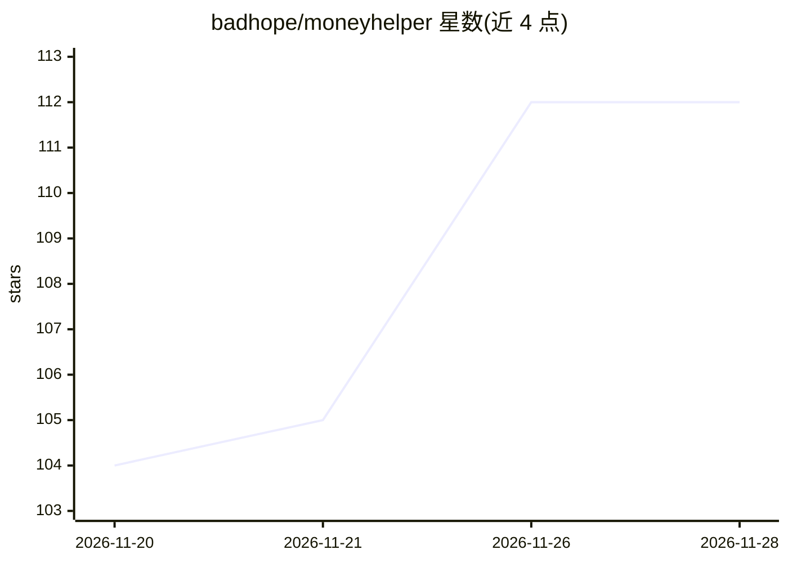

# badhope/moneyhelper

⭐ 112 · Python · MIT · 推送 2026-11-25 · [GitHub](https://github.com/badhope/moneyhelper) · [官网](https://badhope.github.io/moneyhelper/) · 个人维护 · 中文 README

**自托管记账软件：一句话生成凭证、对账并结账**

自托管财务软件，覆盖个人与企业两类账套：一句话录入多笔交易，支持微信/支付宝/银行 CSV/PDF/发票二维码与 OCR 导入；提供复式总账（科目、期间、凭证、试算平衡）、银行对账、月末自动结账、多主体合并、预算与现金计划。所有数字由确定性计算引擎生成，模型仅负责组织措辞，每项数字带来源记录；通过 MCP 向 Claude 等 MCP 客户端暴露操作接口。

## 筛选速览

| 维度 | 判定 | 备注 |
|---|---|---|
| AI 角色 | `ai-enhanced` | 去掉 AI 部分产品仍成立 |
| 许可风险 | `permissive` | MIT |
| 部署形态 | `self-host` | docker 或自建部署 |
| 模型依赖 | — | README 未给出锁定关系 |
| 硬件要求 | — | 无带数字的原话,不猜 |
| 安装摩擦 | `low` | 无编译、无系统依赖或容器化 |
| 成熟度 | — | 结构信号不足 |

## 能力要点

- 确定性计算引擎出数、模型仅生成文字表述，数字不可由模型编造
- 复式总账全流程：凭证草稿→过账→冲销、期末锁定、试算平衡
- 微信/支付宝/银行 CSV/PDF/发票二维码与 OCR 原生导入
- 通过 MCP 暴露全部能力，供 MCP 客户端驱动记账

## 适用场景

- 一句话把午餐、打车等多笔日常开支记入个人账本
- 企业管理多部门、多主体的总账、报销与采购付款流程
- 月末自动结账与银行对账，生成可审计的申报交接包

## 场景标签

`OCR` `数据分析` · 领域:效率与自动化

## 证据(README 行号)

> L19: Here the split is the other way round: a deterministic calculation engine fills in every figure, and the model is o
> L31: **Personal.** One sentence becomes several entries — `lunch 45, taxi 28` is two transactions, not one. WeChat Pay, 
> L77: **Everything is addressable by your own agent.** The same capabilities are exposed through MCP, so Claude, Codex or

## 星数曲线

2026-11-20 104 → 2026-11-28 112（+8）

---
*卡片 v1 · prompt 1.4 · 生成 2026-11-28 · 置信度 high · 依据 README sha `873fc2b460ec` · [字段定义](../../DATASET.md)*
