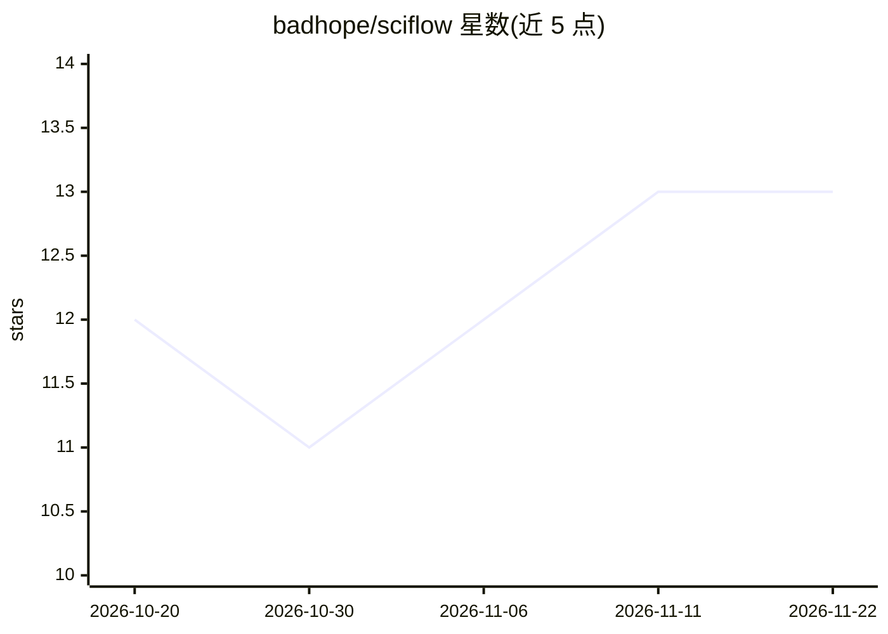

# badhope/sciflow

⭐ 13 · TypeScript · MIT · 推送 2026-11-21 · [GitHub](https://github.com/badhope/sciflow) · [官网](https://badhope.github.io/sciflow/) · 个人维护 · 中文 README

**本地优先的自主科研循环与论文写作流水线平台**

本地运行的科研平台：多 Agent 自主研究循环（PI/实验者/批评者/独立专家评审），协议执行前经人工或专家 Agent 审批门；长文写作按卷/章逐章生成并依赖压缩摘要保持跨章连贯。核心机制是确定性质量门（七维规则评分+稳定指纹）与三级引用溯源（引用锚点→引用行→参考文献行），空参考文献池直接禁止引用标记。支持 OpenAI 兼容/Anthropic/Gemini 协议、本地 Ollama/GGUF、桌面应用与无头 CLI，无 API key 时可用 mock 网关跑完整流水线。

## 筛选速览

| 维度 | 判定 | 备注 |
|---|---|---|
| AI 角色 | `ai-native` | 本体是模型或模型工具 |
| 许可风险 | `permissive` | MIT |
| 部署形态 | `self-host` | docker 或自建部署 |
| 模型依赖 | local-ok | 支持本地模型 |
| 硬件要求 | — | 无带数字的原话,不猜 |
| 安装摩擦 | `low` | 无编译、无系统依赖或容器化 |
| 成熟度 | — | 结构信号不足 |

## 能力要点

- 确定性质量门：七维规则评分，同文本同分数，LLM 分数仅作参考
- 三级引用溯源：幽灵锚点/孤儿条目/重复 DOI 按数量报告
- SQLite FTS5 + sqlite-vec 检索与 OpenAlex/Crossref/arXiv 文献查询
- 无 API key 时以 AI_MOCK=1 本地跑通完整流水线

## 适用场景

- 自动化文献调研并生成带可验证引用的稿件
- 运行带人工/专家门控的自主研究循环
- 本地环境无 API key 演示完整科研流水线
- 逐章生成跨章连贯的长篇著作

## 场景标签

`科研工具` `多智能体` `RAG` `AI 写作` · 领域:Agent 开发

## 证据(README 行号)

> L17: |**Autonomous research loop**|Program → Cycle → Question → Hypothesis → Protocol → Run → Claim → Evidence. PI, Expe
> L24: |**Manuscript pipeline**|Topic validation → literature survey → outline gate → section drafting → quality gate → po
> L30: A verified run on 2026-11-13 with a real model produced a 10,834-character manuscript from 20 retrieved references:

## 星数曲线

2026-10-20 12 → 2026-11-22 13（+1）

---
*卡片 v1 · prompt 1.4 · 生成 2026-11-18 · 置信度 high · 依据 README sha `ebb37b5316a3` · [字段定义](../../DATASET.md)*
