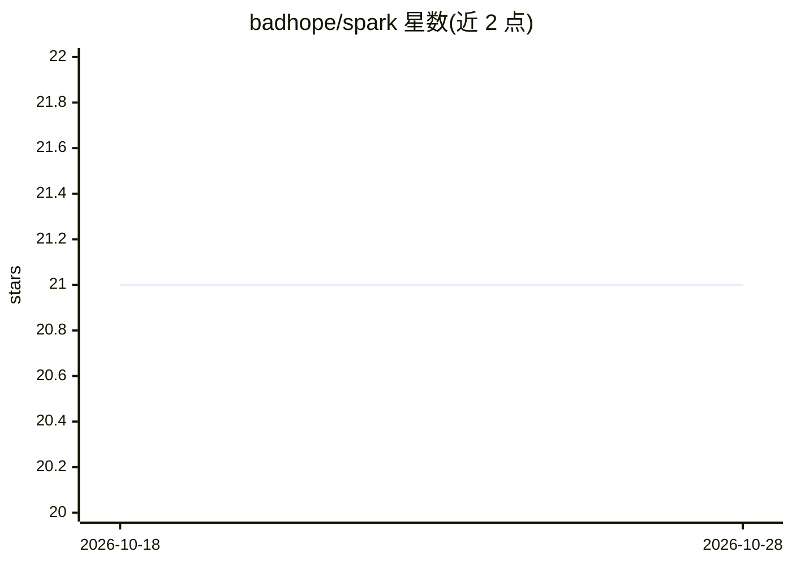

# badhope/spark

⭐ 21 · Python · MIT · 推送 2026-10-25 · [GitHub](https://github.com/badhope/spark) · [官网](https://github.com/badhope/spark#readme) · 个人维护 · 中文 README

**本地自托管 AI 编程智能体，同一核心提供六种运行形态**

Spark 是自托管的 AI coding agent：控制流基于 LangGraph，LiteLLM 统一接入任意 OpenAI 兼容端点（DeepSeek/Qwen/GLM/Kimi/Ollama 等）。同一 AgentLoop 以 Web UI、桌面窗口、TUI、CLI、ACP（IDE）和 MCP server 六种形态运行，内置审批模式与沙箱分级、工作区检查点回滚、task 分支工具、AI 审查 diff、凭据池与模型回退链、AGENTS.md 与向量长期记忆。安装提供一行 curl 脚本，无 API key 时以 mock 演示模式启动。

## 筛选速览

| 维度 | 判定 | 备注 |
|---|---|---|
| AI 角色 | `ai-native` | 本体是模型或模型工具 |
| 许可风险 | `permissive` | MIT |
| 部署形态 | `None` |  |
| 模型依赖 | local-ok | 支持本地模型 |
| 硬件要求 | — | 无带数字的原话,不猜 |
| 安装摩擦 | `medium` | 含编译或系统依赖之一 |
| 成熟度 | — | 结构信号不足 |

## 能力要点

- 六种形态共享同一 AgentLoop 与权限策略
- 六级审批×四级沙箱与通配符规则引擎（deny 优先）
- 每轮工作区 tar.gz 快照，可回滚文件与对话（含非 git 目录）
- 同时作为 MCP 客户端与 MCP server（暴露 36 个工具）

## 适用场景

- 在本地/SSH 终端或桌面窗口中让 AI 读写代码并执行命令
- 通过 CLI 的 NDJSON 事件流接入 CI 自动化任务
- 把内置工具作为 MCP server 暴露给其他 agent
- 审查未提交 diff 并输出 JSON 结果用于 CI

## 场景标签

`编码 Agent` `Agent 记忆` · 领域:Agent 开发

## 证据(README 行号)

> L11: An AI coding agent where **approval, sandboxing, rollback and provider resilience are
> L30: |**Six surfaces, one brain**|Web UI · native desktop window · Textual TUI · scriptable CLI · ACP (Zed & co.) · MCP 

## 星数曲线

2026-10-18 21 → 2026-10-28 21（+0）

---
*卡片 v1 · prompt 1.4 · 生成 2026-10-28 · 置信度 high · 依据 README sha `3d3b0937521b` · [字段定义](../../DATASET.md)*
