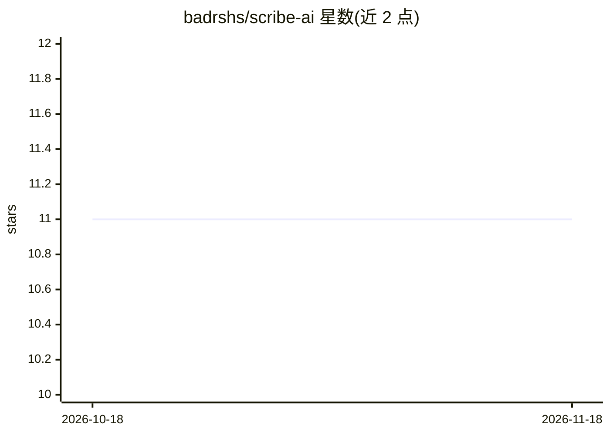

# badrshs/scribe-ai

⭐ 11 · PHP · MIT · 推送 2026-06-01 · [GitHub](https://github.com/badrshs/scribe-ai) · [官网](https://badrshs.github.io/scribe-ai/) · 个人维护

**Laravel 自动内容管线：抓取→AI 改写→生成配图→多渠道发布**

一个 Laravel 11/12（PHP 8.2+）包，将任意 URL 经有序管道处理：抓取正文、调用 AI 改写成文章、用 DALL-E 等生成封面图并优化为 WebP、写入数据库并发布到 Telegram/Facebook/Blogger/WordPress 等渠道。采用队列优先、驱动式设计，AI 提供商、输入源、发布渠道均可通过实现接口扩展；每阶段派发 Laravel 事件，运行记录持久化到数据库并支持从失败阶段恢复。面向需要在 Laravel 应用中自动化内容生产与分发的开发者。

## 筛选速览

| 维度 | 判定 | 备注 |
|---|---|---|
| AI 角色 | `ai-native` | 本体是模型或模型工具 |
| 许可风险 | `permissive` | MIT |
| 部署形态 | `None` |  |
| 模型依赖 | local-ok | 支持本地模型 |
| 硬件要求 | — | 无带数字的原话,不猜 |
| 安装摩擦 | `low` | 无编译、无系统依赖或容器化 |
| 成熟度 | — | 结构信号不足 |

## 能力要点

- 6 阶段管道（抓取/改写/生图/优化/入库/发布），各阶段可跳过、替换、重排
- 驱动式 AI 提供商：OpenAI、Claude、Gemini、Ollama 内置，支持文本与图片用不同提供商
- 输入源自动检测（web/rss/text）与自定义驱动扩展，发布渠道可扩展
- 运行记录持久化与失败断点恢复（scribe:resume）

## 适用场景

- 把外部网页或 RSS 内容自动改写成文章并发布到多个平台
- 在 Laravel 应用中以 Artisan 命令或编程 API 批量生产配图文章
- 为内容管道接入自定义 AI 提供商或自建发布渠道

## 场景标签

`AI 写作` `图像生成` `工作流自动化` · 领域:效率与自动化

## 证据(README 行号)

> L10: **A Laravel package that turns any URL into a published article - automatically.**
> L12: Scribe AI scrapes a webpage, rewrites the content with AI, generates a cover image, optimises it for the web, saves
> L74: |2|**AI Rewrite**|Sends the raw content to OpenAI and returns a polished article|

## 星数曲线

2026-10-18 11 → 2026-11-18 11（+0）

---
*卡片 v1 · prompt 1.4 · 生成 2026-11-18 · 置信度 high · 依据 README sha `2e75dd8ee2cc` · [字段定义](../../DATASET.md)*
