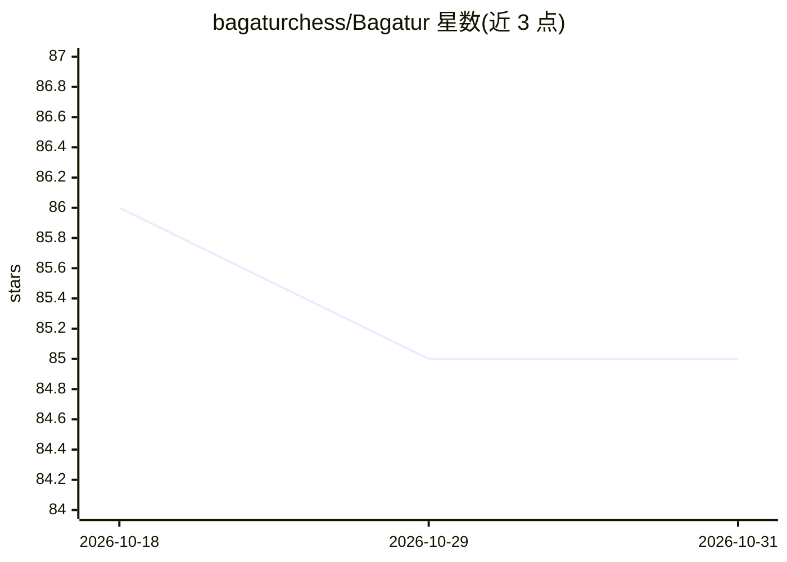

# bagaturchess/Bagatur

⭐ 85 · Java · EPL-2.0 · 推送 2026-06-29 · [GitHub](https://github.com/bagaturchess/Bagatur) · [官网](http://bagaturchess.github.io/Bagatur/) · 个人维护

**Java 编写的 UCI 国际象棋引擎，桌面与 Android 可运行**

用 Java 实现的 UCI 协议国际象棋引擎：桌面端为控制台程序，可接入 Arena 等 UCI 兼容 GUI；Android 端为独立应用（源码另仓）。自 5.0 版起以 NNUE 作为评估函数，附带基于数百万盘大师与引擎对局筛选的开局库，内置 22 个 5 子以内残局 Syzygy 表；SMP 版本经最多 64 核测试并存在已知的 JVM 扩展性限制。运行需 JRE 17+，Windows 发行包带 .exe 启动器，Linux 带 .sh 脚本。CCRL 40/15 官方等级分约 3400。

## 筛选速览

| 维度 | 判定 | 备注 |
|---|---|---|
| AI 角色 | `ai-native` | 本体是模型或模型工具 |
| 许可风险 | `viral` | EPL-2.0 |
| 部署形态 | `desktop` | 安装包/桌面程序 |
| 模型依赖 | — | README 未给出锁定关系 |
| 硬件要求 | — | 无带数字的原话,不猜 |
| 安装摩擦 | `medium` | 含编译或系统依赖之一 |
| 成熟度 | — | 结构信号不足 |

## 能力要点

- NNUE 评估函数（Java 移植，独立子项目）
- SMP 多核版本，测试至 64 核（存在已知 JVM 扩展限制）
- 内置 22 个 Syzygy 残局表，支持在线回退 lichess 表库
- 开局库由过去 20 年数百万盘对局筛选而成

## 适用场景

- 在 Arena 等 UCI 兼容 GUI 中作为对弈/分析引擎
- 多核机器或云虚拟机上运行高强度对弈
- 研究 Java 平台上的国际象棋搜索与 NNUE 评估实现

## 场景标签

 · 领域:游戏/棋类引擎

## 证据(README 行号)

> L62: Since version 5.0, Bagatur uses NNUE as its evaluation function. The Java port lives in its own subproject — see NN
> L5: Bagatur is one of the strongest Java chess engines in the world.

## 星数曲线

2026-10-18 86 → 2026-10-31 85（-1）

---
*卡片 v1 · prompt 1.4 · 生成 2026-10-24 · 置信度 high · 依据 README sha `27ffad6fa33a` · [字段定义](../../DATASET.md)*
