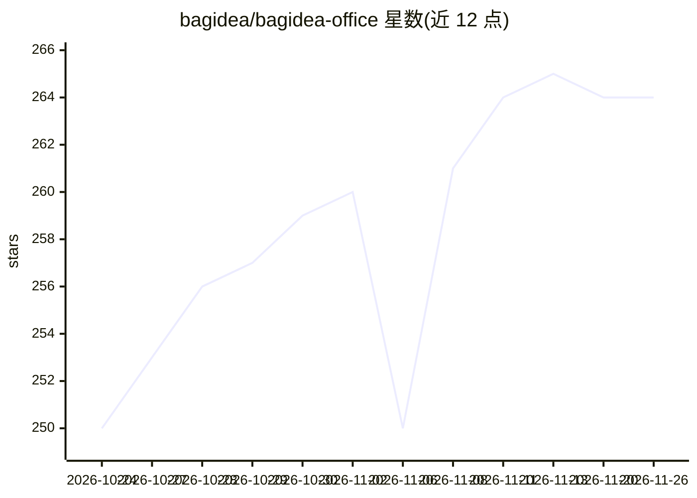

# bagidea/bagidea-office

⭐ 264 · JavaScript · MIT · 推送 2026-11-21 · [GitHub](https://github.com/bagidea/bagidea-office) · [官网](https://bagidea.github.io/bagidea-office/) · 组织维护 · 中文 README

**把 Claude Code 团队变成桌面壁纸上的 2.5D AI 办公室**

以桌面壁纸形式运行的 2.5D 像素风办公室，将 Claude Code 会话、无头运行与自定义脚本渲染为走到工位办公的虚拟员工：支持安全台审批、自主会议、技能学习与插件自提案（需用户逐项批准）。依赖 Claude Code 运行，配置 Gemini/OpenAI 密钥可解锁语音、实时通话与图像生成。通过一键安装器或 npx bagidea 安装，支持 Windows 与 macOS/Linux（beta），内置 15 种语言界面与 Telegram/Discord/LINE/飞书等消息通道。

## 筛选速览

| 维度 | 判定 | 备注 |
|---|---|---|
| AI 角色 | `ai-native` | 本体是模型或模型工具 |
| 许可风险 | `permissive` | MIT |
| 部署形态 | `desktop` | 安装包/桌面程序 |
| 模型依赖 | local-ok | 支持本地模型 |
| 硬件要求 | — | 无带数字的原话,不猜 |
| 安装摩擦 | `high` | 编译与系统依赖俱全 |
| 成熟度 | — | 结构信号不足 |

## 能力要点

- 多 agent 协作：不同角色、技能与可替换模型的大脑，支持委派、幽灵克隆并行与会议汇报
- 知识沉淀：共享 OFFICE.md、每 agent 自动记忆、可复用工作流与可搜索归档
- 自我扩展：agent 可提案工具与插件，经用户批准后成为运行中的真实能力
- 一键安装器或 npx bagidea，桌面壁纸层渲染于图标之后

## 适用场景

- 把 Claude Code 的多 agent 协作以可视化办公室形式摆在桌面上
- 通过 Telegram/Discord/LINE/飞书向 agent 下达指令并完成审批
- 让团队沉淀可复用的工作流与知识，避免每个项目从零开始

## 场景标签

`多智能体` `编码 Agent` · 领域:Agent 开发

## 证据(README 行号)

> L26: your Claude agents — Claude Code sessions, headless runs, custom scripts — as
> L41: **To run it you need Claude Code.** For the

## 星数曲线

2026-10-24 250 → 2026-11-26 264（+14）

---
*卡片 v1 · prompt 1.4 · 生成 2026-11-25 · 置信度 mid · 依据 README sha `abbf32bcbb8f` · [字段定义](../../DATASET.md)*
