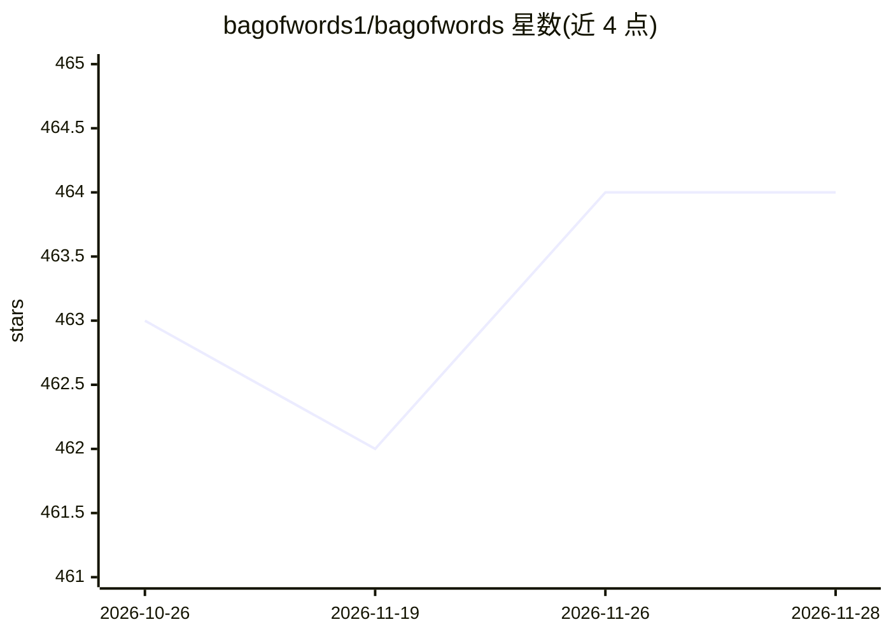

# bagofwords1/bagofwords

⭐ 464 · Python · NOASSERTION · 推送 2026-11-27 · [GitHub](https://github.com/bagofwords1/bagofwords) · [官网](https://bagofwords.com) · 组织维护

**开源 agentic 数据分析平台：对话查询数据并生成报表看板**

BOW 是一个开源 agentic 数据分析平台，将 LLM 接入企业数据库、数据仓库、BI 系统与业务应用，通过 text2sql 生成查询、图表、报表与看板，支持根因分析。每个 agent 配置独立的数据、工具、凭证、指令与权限；同一分析上下文可在聊天、报表、定时任务、Slack/Teams/WhatsApp 等渠道及 MCP 客户端中运行。内置 evals 与自我改进循环、LLM-as-judge 观测与缓存加速查询。Docker 一键部署，支持 SQLite/PostgreSQL，企业版提供 SSO、RBAC、审计等治理能力。

## 筛选速览

| 维度 | 判定 | 备注 |
|---|---|---|
| AI 角色 | `ai-native` | 本体是模型或模型工具 |
| 许可风险 | `none` | NOASSERTION |
| 部署形态 | `self-host` | docker 或自建部署 |
| 模型依赖 | local-ok | 支持本地模型 |
| 硬件要求 | — | 无带数字的原话,不猜 |
| 安装摩擦 | `low` | 无编译、无系统依赖或容器化 |
| 成熟度 | — | 结构信号不足 |

## 能力要点

- 对话式数据分析：生成查询、图表、报表、看板与根因分析
- 每个 agent 独立配置数据、工具、凭证、指令与权限
- evals 与自我改进循环，LLM-as-judge 评分观测
- 自动更新缓存加速分析查询，MCP 网关统一治理

## 适用场景

- 用自然语言查询数据库并生成报表和看板
- 定时调度数据报告并从 webhook 触发分析任务
- 在 Slack/Teams 等渠道内直接向数据提问
- 为团队批量构建和管理数据分析 agent

## 场景标签

`数据分析` · 领域:效率与自动化

## 证据(README 行号)

> L3: ## The open-source agentic analytics platform
> L5: BOW connects any LLM to your data and gives agents the context they need to do useful work.

## 星数曲线

2026-10-26 463 → 2026-11-28 464（+1）

---
*卡片 v1 · prompt 1.4 · 生成 2026-11-26 · 置信度 high · 依据 README sha `7846ead311d5` · [字段定义](../../DATASET.md)*
