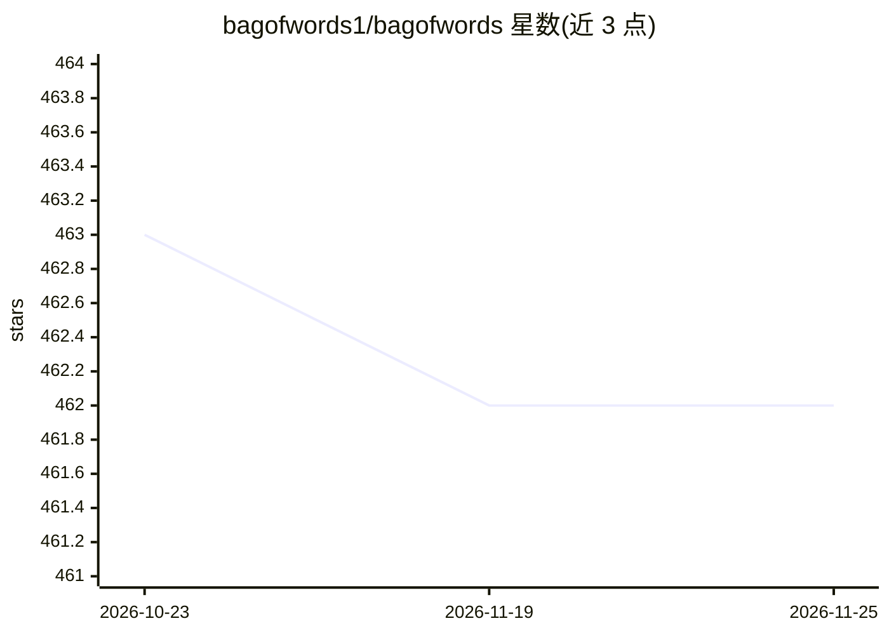

# bagofwords1/bagofwords

⭐ 462 · Python · NOASSERTION · 推送 2026-11-23 · [GitHub](https://github.com/bagofwords1/bagofwords) · [官网](https://bagofwords.com) · 组织维护

**开源 agentic 数据分析平台：对话查询数据并带记忆与可观测性**

BOW 是一个开源的 agentic 分析平台，将 LLM 接入企业数据，为每个 agent 配置独立的数据、工具、凭证、指令与权限；同一分析上下文可用于聊天、报表、仪表盘、自动化任务、团队频道及 MCP 客户端。内置 eval 与自我改进循环、LLM-as-judge 观测评分、查询缓存加速（宣称 10–1000×）、RBAC/审计/SSO 治理。通过 Docker 部署，支持 SQLite 或 PostgreSQL 后端，另有 Docker Compose 与 Kubernetes 部署文档。

## 筛选速览

| 维度 | 判定 | 备注 |
|---|---|---|
| AI 角色 | `ai-ecosystem` | LLM/agent 周边工具 |
| 许可风险 | `none` | NOASSERTION |
| 部署形态 | `self-host` | docker 或自建部署 |
| 模型依赖 | local-ok | 支持本地模型 |
| 硬件要求 | — | 无带数字的原话,不猜 |
| 安装摩擦 | `low` | 无编译、无系统依赖或容器化 |
| 成熟度 | — | 结构信号不足 |

## 能力要点

- 每个 agent 独立配置数据、工具、凭证、指令与权限
- eval 失败时可起草指令修复并重跑的自我改进循环
- 自动更新缓存加速分析查询（10–1000×）
- MCP 网关：统一治理 agent 与 MCP 服务器/客户端的连接

## 适用场景

- 用自然语言查询数据库并生成报表与仪表盘
- 把同一套分析 agent 跑进 Slack/Teams/Excel 等渠道
- 定时调度报表或由 webhook 触发数据调查
- 需要 RBAC、审计日志与 SSO 的团队级分析治理

## 场景标签

`数据分析` · 领域:效率与自动化

## 证据(README 行号)

> L5: BOW connects any LLM to your data and gives agents the context they need to do useful work.
> L98: BOW sits between your models, enterprise data, tools, and channels. It builds a governed analysis context for each 
> L100: Bring your own models and infrastructure. Connect databases, warehouses, BI systems, files, business apps, MCP ser

## 星数曲线

2026-10-23 463 → 2026-11-25 462（-1）

---
*卡片 v1 · prompt 1.4 · 生成 2026-11-25 · 置信度 high · 依据 README sha `b73b10ad4e00` · [字段定义](../../DATASET.md)*
