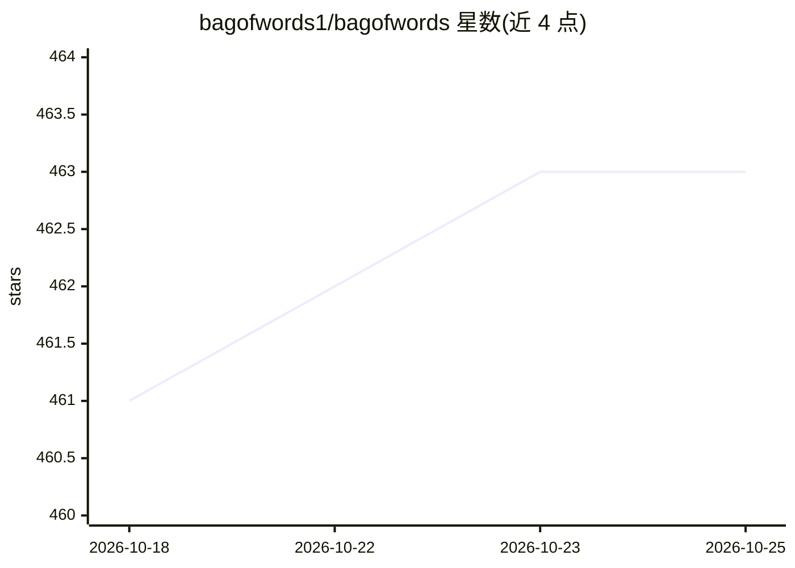

# bagofwords1/bagofwords

⭐ 463 · Python · NOASSERTION · 推送 2026-10-24 · [GitHub](https://github.com/bagofwords1/bagofwords) · [官网](https://bagofwords.com) · 组织维护

**开源智能体分析平台：连接任意 LLM 与企业数据**

Bag of Words 将 LLM 连接到数据库、数仓、BI 系统、业务应用、文件、MCP 服务器与自定义 API，为每个 agent 配置专属数据、工具、凭证、指令与权限，在聊天中完成查询、报表、仪表盘与根因分析。同一 agent 可运行于 Web、Teams/Slack/WhatsApp/邮件、Excel、定时任务、webhook 及 MCP 客户端。内置评测与自我改进循环、运行级可观测性（LLM-as-judge 评分）、自动更新查询缓存与 RBAC/SSO 等治理能力。通过 Docker 部署，支持自托管，使用自带模型 API key。

## 筛选速览

| 维度 | 判定 | 备注 |
|---|---|---|
| AI 角色 | `ai-ecosystem` | LLM/agent 周边工具 |
| 许可风险 | `none` | NOASSERTION |
| 部署形态 | `self-host` | docker 或自建部署 |
| 模型依赖 | local-ok | 支持本地模型 |
| 硬件要求 | — | 无带数字的原话,不猜 |
| 安装摩擦 | `low` | 无编译、无系统依赖或容器化 |
| 成熟度 | — | 结构信号不足 |

## 能力要点

- 每个 agent 独立配置数据、工具、凭证、指令与权限
- 支持 20+ 数据库/数仓连接器与 MCP 网关
- 评测失败时自我改进循环自动起草指令修复并重跑
- 自动更新缓存加速分析查询（10–1000×）
- 全链路可观测：消息、查询、工具调用、延迟、成本与失败

## 适用场景

- 用对话方式对企业数据做查询、报表与根因分析
- 把分析上下文固化为定时报表与事件驱动的自动化任务
- 在 Teams/Slack 等渠道以受治理方式运行数据 agent
- 通过评测与自我改进循环提升数据 agent 可靠性

## 场景标签

`数据分析` `LLM 可观测性` `工作流自动化` · 领域:效率与自动化

## 证据(README 行号)

> L3: ## The open-source agentic analytics platform
> L5: BOW connects any LLM to your data and gives agents the context they need to do useful work.
> L100: Bring your own models and infrastructure. Connect databases, warehouses, BI systems, files, business apps, MCP ser

## 星数曲线

2026-10-18 461 → 2026-10-25 463（+2）

---
*卡片 v1 · prompt 1.4 · 生成 2026-10-22 · 置信度 high · 依据 README sha `a4845aa37f16` · [字段定义](../../DATASET.md)*
