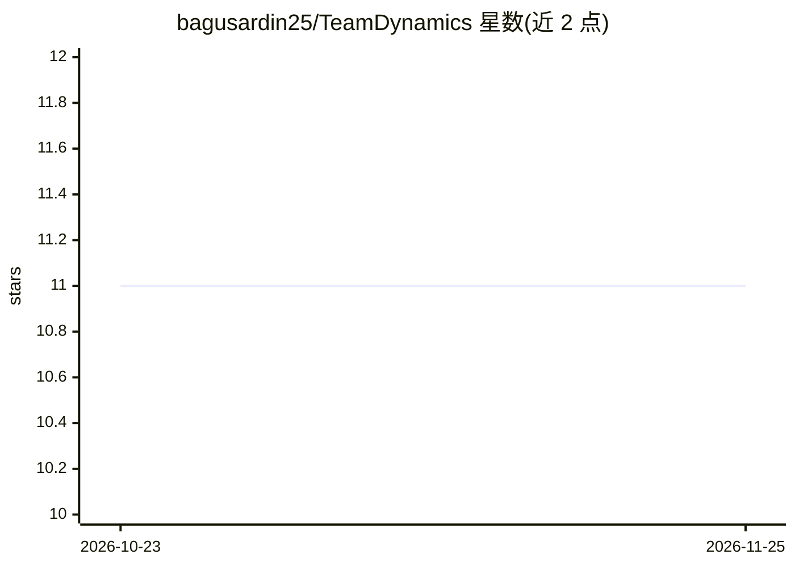

# bagusardin25/TeamDynamics

⭐ 11 · TypeScript · 推送 2026-07-21 · [GitHub](https://github.com/bagusardin25/TeamDynamics) · [官网](https://teamdynamics.vercel.app) · 个人维护

**多智能体模拟平台：预演团队危机与决策后果**

TeamDynamics 是一个多智能体 AI 模拟平台：用户构建带有 5 维人格特征的 AI 团队，注入公司危机场景，通过 WebSocket 实时观察智能体的公开讨论、隐藏想法、投票决策与团队健康、业务指标的联动演化；支持 God-Mode 干预（预览、回执、撤销）、经济状态层、层级加权投票，并可上传文档自动提取风险与危机建议、生成结业报告（PDF 导出）。前端 Next.js + 后端 FastAPI + PostgreSQL，需至少一个 LLM API key；公共 Quick Demo 使用确定性响应无需 key。

## 筛选速览

| 维度 | 判定 | 备注 |
|---|---|---|
| AI 角色 | `ai-native` | 本体是模型或模型工具 |
| 许可风险 | `none` | — |
| 部署形态 | `library` | 以包/库形式分发 |
| 模型依赖 | locked-api |  |
| 硬件要求 | — | 无带数字的原话,不猜 |
| 安装摩擦 | `low` | 无编译、无系统依赖或容器化 |
| 成熟度 | — | 结构信号不足 |

## 能力要点

- 5 维人格系统的心理化智能体与隐藏内心想法展示
- God-Mode 干预控制台：预览、确认、回执与安全撤销
- BYO-AI：可按智能体混合 OpenAI/Gemini/OpenRouter 等 LLM 提供方
- 上传 PDF/DOCX/CSV/XLSX 由 AI 提取团队风险与危机建议

## 适用场景

- 在真实危机发生前预演团队决策与压力反应
- 培训中观察干预措施对士气与业务指标的影响
- 从公司文档自动生成危机场景与模拟参数

## 场景标签

`多智能体` `文档解析` · 领域:Agent 开发

## 证据(README 行号)

> L6:  A living multi-agent AI crisis lab for people, decisions, and leadership.
> L23: alliances, decisions, and business metrics evolve together in real time.
> L134: Mix and match **LLM providers** (OpenAI, Google Gemini, OpenRouter) per-agent for behavioral diversity. Supports C

## 星数曲线

2026-10-23 11 → 2026-11-25 11（+0）

---
*卡片 v1 · prompt 1.4 · 生成 2026-11-18 · 置信度 mid · 依据 README sha `c204bc761962` · [字段定义](../../DATASET.md)*
