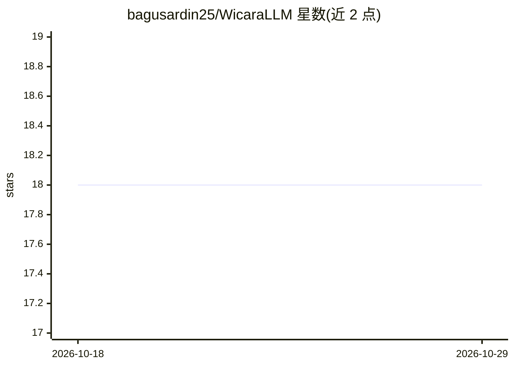

# bagusardin25/WicaraLLM

⭐ 18 · Python · Apache-2.0 · 推送 2026-10-12 · [GitHub](https://github.com/bagusardin25/WicaraLLM) · [官网](https://huggingface.co/num1notsvn/wicara-56m-chat) · 个人维护

**从零训练的印尼语 56M 参数小型语言模型及全套代码**

Wicara 是从零在 PyTorch 中实现的印尼语小型语言模型（Llama 风格架构：RMSNorm、RoPE、GQA、SwiGLU、tied embeddings），在单张 RTX 4050 6GB 上以 1.12B token 印尼语真实语料（OpenSubtitles/FineWeb-2/维基等）预训练约 11 小时，再用 39,400 条示例做 SFT 得到对话版 wicara-56m-chat。仓库包含数据管道、训练与推理脚本，发布 HF 权重、GGUF（Ollama/LM Studio）、HF Space 与 Colab demo。自称限制：不推理、不计 factual 可靠性，上下文 512 token。代码 Apache-2.0，base 权重未发布。

## 筛选速览

| 维度 | 判定 | 备注 |
|---|---|---|
| AI 角色 | `ai-native` | 本体是模型或模型工具 |
| 许可风险 | `permissive` | Apache-2.0 |
| 部署形态 | `desktop` | 安装包/桌面程序 |
| 模型依赖 | local-ok | 支持本地模型 |
| 硬件要求 | `gpu-8g` | |
| 安装摩擦 | `low` | 无编译、无系统依赖或容器化 |
| 成熟度 | — | 结构信号不足 |

## 能力要点

- 从零实现数据、tokenizer、架构、训练与推理（无现成模型/API）
- Llama 风格架构：RMSNorm、RoPE、GQA 2:1、SwiGLU、tied embeddings
- 1.12B token 印尼语真实语料（无合成），Chinchilla 附近配比
- 提供 GGUF 量化版（Q8_0 约 70MB）可在 Ollama/LM Studio 运行

## 适用场景

- 在 6GB 显存的笔记本 GPU 上本地运行印尼语对话模型
- 学习从零构建与训练小型语言模型的完整流程
- 研究低资源/印尼语 NLP 的数据配比与小模型行为

## 场景标签

`模型训练` `教程课程` · 领域:学习与行业

## 证据(README 行号)

> L9: Model bahasa Indonesia 56 juta parameter. Dilatih dari nol di satu laptop
> L14: Data, tokenizer, arsitektur, training, inference — kami tulis sendiri di
> L52: `56m` / `350m` / `1b` — jumlah parameter. `base` pretrain, `chat` sudah SFT.

## 星数曲线

2026-10-18 18 → 2026-10-29 18（+0）

---
*卡片 v1 · prompt 1.4 · 生成 2026-10-29 · 置信度 high · 依据 README sha `99941263feb5` · [字段定义](../../DATASET.md)*
