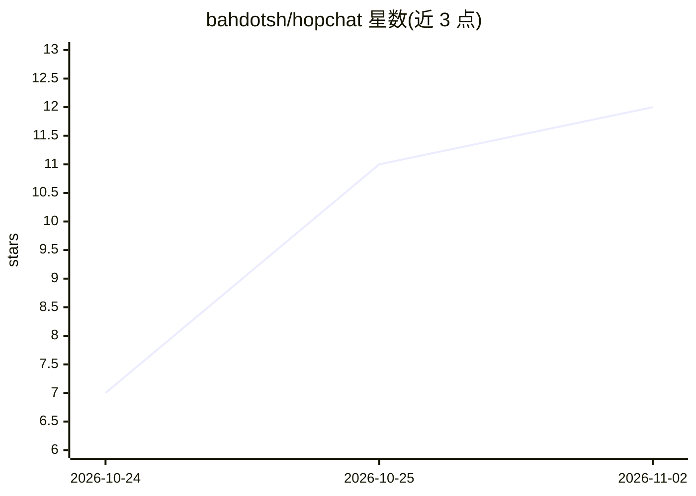

# bahdotsh/hopchat

⭐ 12 · Rust · MIT · 推送 2026-10-23 · [GitHub](https://github.com/bahdotsh/hopchat) · 个人维护

**局域网端到端加密终端聊天应用，附带本地 AI 与智能家居控制**

基于 Rust/ratatui 与 Offline Protocol SDK 的无服务器终端聊天应用：同一局域网内节点通过 UDP 多播与 DNS-SD 自发现，私聊、群组与大厅均以 MLS（RFC 9420）端到端加密，磁盘历史用 XChaCha20-Poly1305 密封。功能含文件传输（单文件至 100 MB）、待办提醒、已读回执与离线补投。AI 为可选功能：经 @ai 调用本地 Ollama 模型，@home 用本地模型驱动 Wiz 灯与 LG webOS 电视等设备，组内可共享一人模型。要求 macOS 或 Linux；提供预编译二进制与 cargo 安装。

## 筛选速览

| 维度 | 判定 | 备注 |
|---|---|---|
| AI 角色 | `ai-enhanced` | 去掉 AI 部分产品仍成立 |
| 许可风险 | `permissive` | MIT |
| 部署形态 | `desktop` | 安装包/桌面程序 |
| 模型依赖 | local-ok | 支持本地模型 |
| 硬件要求 | — | 无带数字的原话,不猜 |
| 安装摩擦 | `medium` | 含编译或系统依赖之一 |
| 成熟度 | — | 结构信号不足 |

## 能力要点

- 无服务器 P2P 局域网发现，MLS（RFC 9420）端到端加密
- @ai 调用本地 Ollama 模型，@home 以自然语言控制 Wiz 灯/LG 电视并查询打印机
- 组内共享模型：一人运行模型，他人经加密会话借用
- 文件传输（100 MB/文件）、待办提醒、离线补投、已读回执

## 适用场景

- 在同一局域网内与家人朋友无账号加密聊天传文件
- 用自然语言控制房间里的智能灯、电视和查询打印机
- 在聊天中向本地模型提问，且数据不出局域网
- 为自己设置待办与定时提醒（数据仅存本机）

## 场景标签

`聊天机器人` `AI 助手` · 领域:对话与助手

## 证据(README 行号)

> L3: **Offline, end-to-end encrypted terminal chat for your local network. No server, no internet, no accounts.**
> L14: hopchat is a terminal chat app built on the Offline Protocol SDK and ratatui. Peers on the same network find each o
> L16: It's also a remote control for the room you're in. Mention `@home` to dim the lights or put something on the TV, an

## 星数曲线

2026-10-24 7 → 2026-11-02 12（+5）

---
*卡片 v1 · prompt 1.4 · 生成 2026-11-02 · 置信度 high · 依据 README sha `598c7fc9450f` · [字段定义](../../DATASET.md)*
