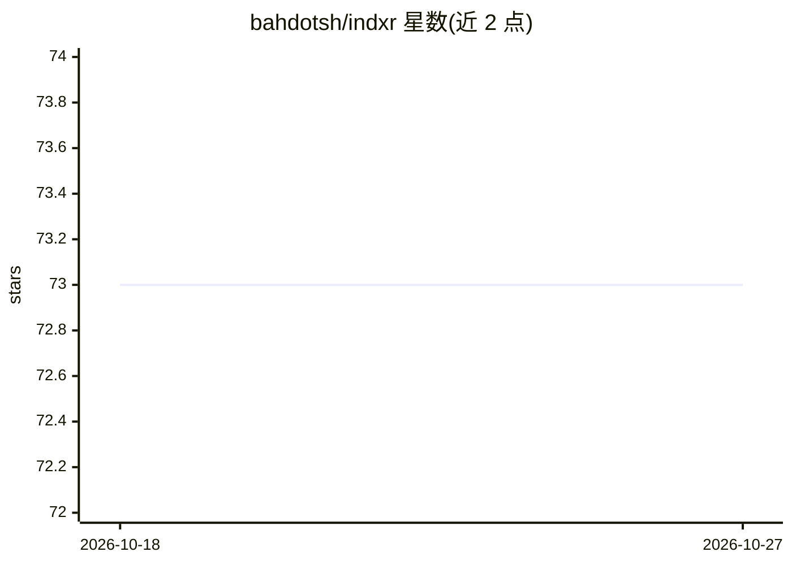

# bahdotsh/indxr

⭐ 73 · Rust · MIT · 推送 2026-04-07 · [GitHub](https://github.com/bahdotsh/indxr) · [官网](https://github.com/bahdotsh/indxr) · 个人维护

**给 AI agent 用的代码库索引器与自更新知识 wiki（MCP 服务器）**

Rust 编写的命令行工具与 MCP 服务器：对代码库建立结构索引（tree-sitter AST 解析 8 种语言、regex 提取另 19 种），提供符号查找、文件摘要、调用者追踪、复杂度热点、类型流追踪、依赖图（DOT/Mermaid/JSON）与 git 声明级 diff 等 26 个 MCP 工具。核心是持久化的代码库知识 wiki（9 个 MCP 工具）：由 agent 生成架构/模块页面，记录失败模式与矛盾追踪，源码变更时自动同步；支持 token 感知的渐进截断。通过 indxr init 一键配置 Claude Code、Cursor、Windsurf、Codex CLI。安装方式为 cargo install 或源码编译。

## 筛选速览

| 维度 | 判定 | 备注 |
|---|---|---|
| AI 角色 | `ai-ecosystem` | LLM/agent 周边工具 |
| 许可风险 | `permissive` | MIT |
| 部署形态 | `library` | 以包/库形式分发 |
| 模型依赖 | — | README 未给出锁定关系 |
| 硬件要求 | — | 无带数字的原话,不猜 |
| 安装摩擦 | `medium` | 含编译或系统依赖之一 |
| 成熟度 | — | 结构信号不足 |

## 能力要点

- 26 个 MCP 工具：符号查找、调用者追踪、复杂度热点、依赖图等
- 9 个 wiki MCP 工具：知识生成/检索/回写/失败记录/矛盾追踪
- 27 种语言支持（tree-sitter AST 8 种 + regex 19 种）
- token 感知输出，渐进截断适配上下文窗口

## 适用场景

- 让编程 agent 在读源码前先通过索引和 wiki 理解代码库结构
- 团队沉淀架构决策、模块职责与失败模式，供后续 agent 检索
- 生成代码库依赖图与复杂度热点报告

## 场景标签

`Agent 记忆` · 领域:Agent 开发

## 证据(README 行号)

> L14: - **9 wiki MCP tools** — `wiki_generate`, `wiki_search`, `wiki_read`, `wiki_contribute`, `wiki_update`, `wiki_compo
> L16: - **26-tool MCP server** (3 compound default + 23 granular via `--all-tools`) — symbol lookup, file summaries, call
> L129: JSON-RPC 2.0 over stdin/stdout (or Streamable HTTP with `--features http`). 3 compound tools listed by default; `-

## 星数曲线

2026-10-18 73 → 2026-10-27 73（+0）

---
*卡片 v1 · prompt 1.4 · 生成 2026-10-24 · 置信度 high · 依据 README sha `b470f22c04e0` · [字段定义](../../DATASET.md)*
