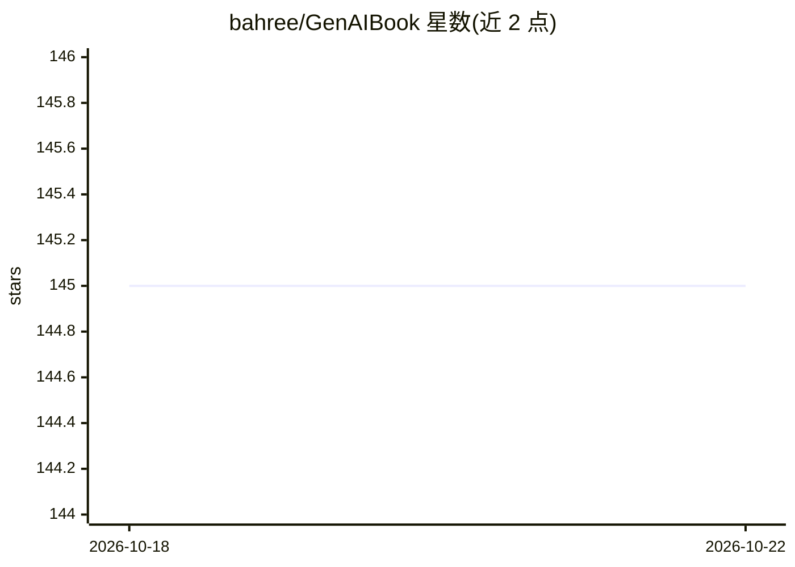

# bahree/GenAIBook

⭐ 145 · Python · MIT · 推送 2025-10-27 · [GitHub](https://github.com/bahree/GenAIBook) · [官网](https://www.manning.com/books/generative-ai-in-action) · 个人维护

**《Generative AI in Action》书籍配套代码与论文清单仓库**

Manning 出版书籍 Generative AI in Action 的官方代码仓库：按章节组织示例代码（chapters 目录）、通用工具函数（utils 目录）、可本地运行的整合性 Web 应用（webapp 目录），以及按章节组织的研究论文索引（paper 目录）。要求 Python 3.7.1+（书中用 3.11.3）、IDE 与 Git，推荐使用 conda 等包管理器；代码兼容 OpenAI v1.0 API，旧版 openai 包需升级。仓库采用 MIT 许可证。

## 筛选速览

| 维度 | 判定 | 备注 |
|---|---|---|
| AI 角色 | `ai-knowledge` | 知识聚合/清单类 |
| 许可风险 | `permissive` | MIT |
| 部署形态 | `library` | 以包/库形式分发 |
| 模型依赖 | — | README 未给出锁定关系 |
| 硬件要求 | — | 无带数字的原话,不猜 |
| 安装摩擦 | `low` | 无编译、无系统依赖或容器化 |
| 成熟度 | — | 结构信号不足 |

## 能力要点

- 按章节组织的示例代码（chapters/ch{N} 结构）
- 可本地运行的整合 Web 应用（webapp 目录）
- 按章节组织的研究论文索引
- 兼容 OpenAI v1.0 新 API，附旧包升级指引

## 适用场景

- 跟随书籍章节动手运行 Generative AI 示例代码
- 在本地跑通整合多种概念的参考 Web 应用
- 按章节查找 LLM 与生成式 AI 的研究论文线索

## 场景标签

`教程课程` · 领域:学习与行业

## 证据(README 行号)

> L2: Welcome to the code repo associated with my book **Generative AI in Action**, published by Manning.
> L9: * Code from the different examples in the book.

## 星数曲线

2026-10-18 145 → 2026-10-22 145（+0）

---
*卡片 v1 · prompt 1.4 · 生成 2026-10-22 · 置信度 mid · 依据 README sha `6ba63458cae9` · [字段定义](../../DATASET.md)*
