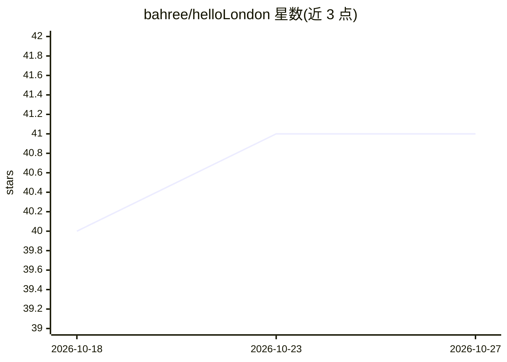

# bahree/helloLondon

⭐ 41 · Python · MIT · 推送 2025-11-01 · [GitHub](https://github.com/bahree/helloLondon) · [官网](https://blog.desigeek.com/post/2025/09/building-llm-from-scratch-part1/) · 个人维护

**面向教学的历史英语 LLM 全流程构建项目（含已发布模型）**

以 1500-1850 年伦敦历史文本（218+ 来源、500M+ 字符）为语料，从零实现 GPT 风格模型的 4 部分教学项目：数据收集、自定义分词器（30k 词表、150+ 历史特殊 token）、训练（DDP 多 GPU、WandB）、评测（ROUGE/MMLU/HellaSWAG）与部署。产出两个仅参数量不同的模型（117M SLM 与 354M），SLM 已发布至 Hugging Face 可直接推理。声明为教学用途，不覆盖生产级规模。使用者可先跑已发布模型，或按完整流程自行训练。

## 筛选速览

| 维度 | 判定 | 备注 |
|---|---|---|
| AI 角色 | `ai-native` | 本体是模型或模型工具 |
| 许可风险 | `permissive` | MIT |
| 部署形态 | `None` |  |
| 模型依赖 | — | README 未给出锁定关系 |
| 硬件要求 | — | 无带数字的原话,不猜 |
| 安装摩擦 | `medium` | 含编译或系统依赖之一 |
| 成熟度 | — | 结构信号不足 |

## 能力要点

- 两个同架构模型：117M SLM 与 354M Regular，SLM 已发布 Hugging Face
- 218+ 历史来源、500M+ 字符的数据集与自动采集脚本（Archive.org）
- 自定义分词器：30k 词表含 150+ 历史语言/伦敦专有特殊 token
- 支持 PyTorch checkpoint 与 Hugging Face 两种推理路径

## 适用场景

- 学习从数据收集到训练部署的 LLM 完整构建流程
- 直接用已发布 SLM 生成都铎至维多利亚时期风格英文
- 研究历史语料的自定义分词与评测方法

## 场景标签

`教程课程` `模型训练` `模型评测` · 领域:评测与运维

## 证据(README 行号)

> L4: **Learn to build Large Language Models from the ground up** using historical London texts (1500-1850). This comprehe
> L10: > **🚀 Ready to Use**: The London Historical SLM is already published and available on Hugging Face!
> L91: from transformers import AutoTokenizer, AutoModelForCausalLM

## 星数曲线

2026-10-18 40 → 2026-10-27 41（+1）

---
*卡片 v1 · prompt 1.4 · 生成 2026-10-25 · 置信度 high · 依据 README sha `88c5b1d76e31` · [字段定义](../../DATASET.md)*
