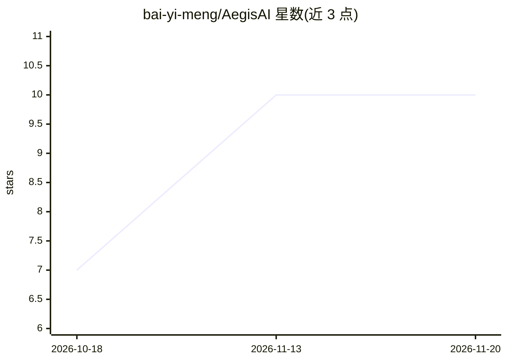

# bai-yi-meng/AegisAI

⭐ 10 · Python · 推送 2026-09-07 · [GitHub](https://github.com/bai-yi-meng/AegisAI) · 个人维护 · 中文 README

**面向授权测试与教学的 LLM 驱动自动化渗透测试系统**

AegisAI 由大模型驱动智能体按「侦察→资产枚举→漏洞检测→AI 分析与报告」流程自主规划渗透测试，集成 Nmap 端口扫描、Web 指纹、目录枚举、5 类 Web 漏洞检测器（带对照验证防误报）与本地 CVE 知识库，输出 Markdown/HTML 报告并经 WebSocket 实时推送决策过程。提供内置本地演练靶场供无外部靶机演示；未配置 API Key 时以离线策略引擎运行全部功能。强制授权确认与 scope 限定，仅做检测验证不投放利用载荷。

## 筛选速览

| 维度 | 判定 | 备注 |
|---|---|---|
| AI 角色 | `ai-enhanced` | 去掉 AI 部分产品仍成立 |
| 许可风险 | `none` | — |
| 部署形态 | `library` | 以包/库形式分发 |
| 模型依赖 | locked-api |  |
| 硬件要求 | — | 无带数字的原话,不猜 |
| 安装摩擦 | `low` | 无编译、无系统依赖或容器化 |
| 成熟度 | — | 结构信号不足 |

## 能力要点

- LLM 智能体逐步自主决策工具调用，异常时回退内置策略引擎
- 支持 DeepSeek/GLM/通义千问/Kimi/OpenAI 及任意 OpenAI 兼容接口，未配 Key 可离线运行
- 内置本地演练靶场（127.0.0.1:9001），项目自包含可移植
- 检测器带对照验证防误报，报告含证据、AI 分析与修复建议

## 适用场景

- 在授权范围内对目标站点做自动化渗透测试与报告生成
- 教学中无外部靶机即可演示完整渗透测试流程
- 接入国内大模型 API 作为安全检测的决策引擎

## 场景标签

`网络安全` · 领域:学习与行业

## 证据(README 行号)

> L5: AegisAI（神盾）是一个由大模型驱动的自动化渗透测试系统：智能体自主规划「**侦察 → 资产枚举 → 漏洞检测 → AI 分析与报告**」的完整测试流程，集成 Nmap 端口扫描、Web 指纹识别、敏感路径枚举、SQL 注入 /
> L16: |🔌 大模型可插拔|支持 DeepSeek / 智谱 GLM / 通义千问 / Kimi / OpenAI 及任意 OpenAI 兼容接口；**未配置 Key 时以离线策略引擎运行**（功能完整，可演示）|

## 星数曲线

2026-10-18 7 → 2026-11-20 10（+3）

---
*卡片 v1 · prompt 1.4 · 生成 2026-11-19 · 置信度 mid · 依据 README sha `4e3623d209ea` · [字段定义](../../DATASET.md)*
