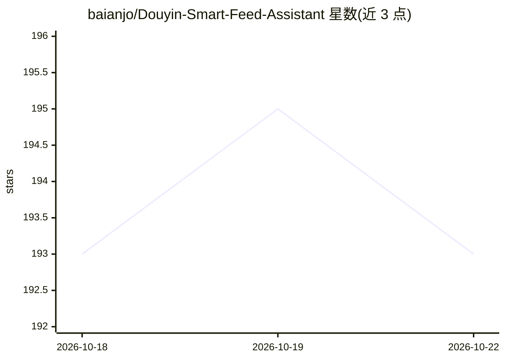

# baianjo/Douyin-Smart-Feed-Assistant

⭐ 193 · TypeScript · MIT · 推送 2026-06-02 · [GitHub](https://github.com/baianjo/Douyin-Smart-Feed-Assistant) · 个人维护 · 中文 README

**用 LLM 自动调教抖音推荐流的油猴脚本，面向普通用户**

运行在抖音网页版的用户脚本（Tampermonkey/Violentmonkey）：提取视频标题、作者、标签，调用 OpenAI 兼容 API（DeepSeek、Kimi、通义千问、智谱 GLM、Gemini 或自定义端点）分析内容，按用户偏好规则自动执行点赞、忽略或“不感兴趣”操作，向推荐算法持续反馈以调整推流方向。内置多套预设模板与自定义规则，配置与 API Key 仅存浏览器本地。需保持标签页可见、不能后台运行，效果受抖音算法与页面结构变更影响，移动端 App 不可用。

## 筛选速览

| 维度 | 判定 | 备注 |
|---|---|---|
| AI 角色 | `ai-native` | 本体是模型或模型工具 |
| 许可风险 | `permissive` | MIT |
| 部署形态 | `library` | 以包/库形式分发 |
| 模型依赖 | locked-api |  |
| 硬件要求 | — | 无带数字的原话,不猜 |
| 安装摩擦 | `low` | 无编译、无系统依赖或容器化 |
| 成熟度 | — | 结构信号不足 |

## 能力要点

- 调用 OpenAI 兼容 API 分析视频标题/作者/标签并自动执行点赞/忽略/不感兴趣
- 支持 DeepSeek、Kimi、通义千问、智谱 GLM、Gemini 及自定义兼容端点
- 内置预设模板（破除信息茧房、青少年引导、效率知识等）与自定义规则
- API Key 与配置仅本地存储（GM_setValue），不经过中间服务器

## 适用场景

- 调整自己的抖音推荐流聚焦特定领域（科普、健身、艺术等）
- 为未成年人或长辈设备过滤不适宜内容
- 通过持续反馈打破单一类型视频的信息茧房

## 场景标签

 · 领域:社交媒体工具/浏览器用户脚本

## 证据(README 行号)

> L24: **抖音推荐影响器** 是一款基于 AI 的自动化工具，通过调用大语言模型分析视频内容（标题、作者、标签等），根据你的偏好规则自动执行点赞、忽略或“不感兴趣”操作，持续向推荐算法反馈你的真实需求。
> L33: - **AI 智能分析**：支持 DeepSeek、Kimi、通义千问、智谱 GLM、Gemini 等多个主流大模型，也支持自定义 OpenAI 兼容 API
> L234: 3. 脚本会自动：

## 星数曲线

2026-10-18 193 → 2026-10-22 193（+0）

---
*卡片 v1 · prompt 1.4 · 生成 2026-10-22 · 置信度 mid · 依据 README sha `a1f52fd08292` · [字段定义](../../DATASET.md)*
