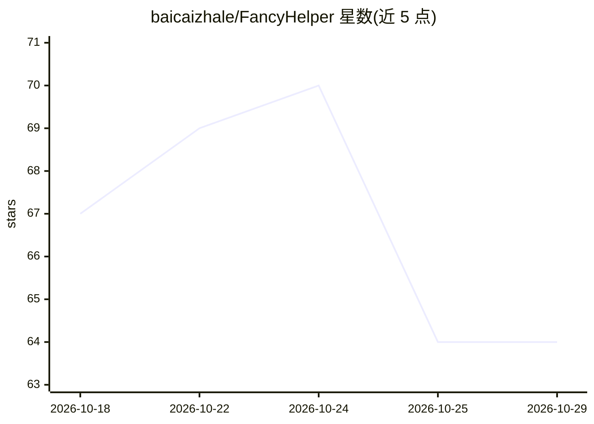

# baicaizhale/FancyHelper

⭐ 64 · Java · GPL-3.0 · 推送 2026-10-25 · [GitHub](https://github.com/baicaizhale/FancyHelper) · [官网](https://modrinth.com/plugin/fancyhelper) · 个人维护 · 中文 README

**Minecraft 服务器管理的游戏内 AI 助手插件**

面向 Spigot/Paper 1.18+（Java 17+）的 Minecraft 服务器插件：玩家在游戏内用 /cli 进入对话，用自然语言说需求，由 AI 生成对应服务器指令，确认后执行，无需背指令或翻 Wiki。支持四种对话模式（普通逐条确认/YOLO/SMART 风险判断/Plan 先规划）、内置 LuckPerms 等插件文档搜索、网页抓取、Skill 技能系统、文件读写工具、MCP 客户端与偏好记忆。默认走 FancyConsole 中转，也支持 OpenAI/DeepSeek/CloudFlare Workers AI 等 OpenAI 兼容端点（BYOK）。必需依赖 ProtocolLib 5.4.0+。

## 筛选速览

| 维度 | 判定 | 备注 |
|---|---|---|
| AI 角色 | `ai-native` | 本体是模型或模型工具 |
| 许可风险 | `viral` | GPL-3.0 |
| 部署形态 | `None` |  |
| 模型依赖 | — | README 未给出锁定关系 |
| 硬件要求 | — | 无带数字的原话,不猜 |
| 安装摩擦 | `medium` | 含编译或系统依赖之一 |
| 成熟度 | — | 结构信号不足 |

## 能力要点

- 自然语言生成服务器指令并确认执行（含 YOLO/SMART/Plan 模式与高危操作确认）
- 内置主流插件文档预设与全网搜索（Tavily/Metaso）、#webfetch 网页抓取
- Skill 技能系统（markdown 知识注入、在线市场安装）与 MCP 客户端扩展
- AI 读写服务器配置文件、待办清单、偏好记忆、会话恢复与自动热更新

## 适用场景

- 在游戏里用对话给玩家调权限、改配置，不用翻 Wiki 背指令
- 让 AI 代为执行批量或复杂服务器管理任务（Plan 模式）
- 结合 Skill 文档与网页抓取查插件用法后直接生成操作指令

## 场景标签

`AI 助手` · 领域:对话与助手

## 证据(README 行号)

> L20: FancyHelper 就是来解决这个问题的。装好之后，你在游戏里直接跟 AI 说需求，比如"把 baicaizhale 设成管理员"，它会自己生成对应的指令，问你确认，然后执行。不用背指令，不用翻文档。
> L26: - **AI 自动生成指令** — 默认走 FancyConsole（免密钥中转），也支持 OpenAI、DeepSeek、CloudFlare Workers AI 等 OpenAI 兼容端点（BYOK 自带密钥）

## 星数曲线

2026-10-18 67 → 2026-10-29 64（-3）

---
*卡片 v1 · prompt 1.4 · 生成 2026-10-24 · 置信度 high · 依据 README sha `280d88395289` · [字段定义](../../DATASET.md)*
