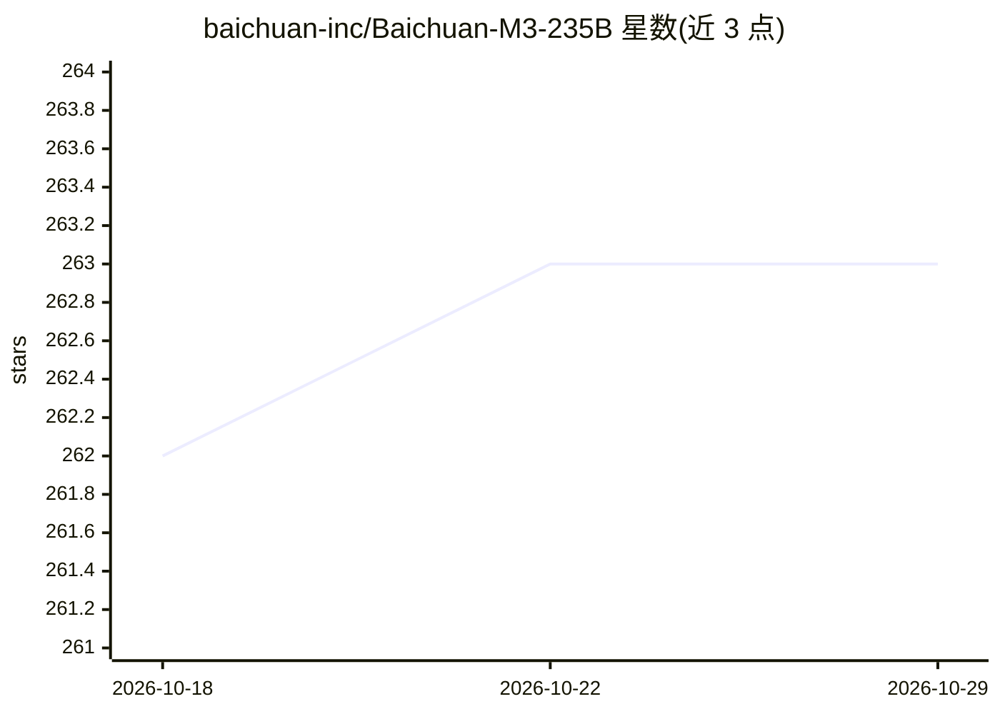

# baichuan-inc/Baichuan-M3-235B

⭐ 263 · Python · Apache-2.0 · 推送 2026-02-09 · [GitHub](https://github.com/baichuan-inc/Baichuan-M3-235B) · 组织维护 · 中文 README

**面向临床决策的 235B 医疗增强大语言模型，供医疗场景部署**

百川智能发布的 235B 参数医疗大语言模型，基于 Qwen3，以临床决策过程建模为训练目标，覆盖病史采集、鉴别诊断、检验检查、精确诊断环节。训练采用 SPAR 分段流水线强化学习与 Fact-Aware RL 事实感知强化学习，并支持 W4 量化（显存占用降至 26%）与 Gated Eagle3 投机解码。提供 Hugging Face 权重与 GPTQ-4bit 版本，可通过 transformers、SGLang 或 vLLM 部署，README 声明在 HealthBench、SCAN-bench 等评测中取得其报告的成绩。许可证为 Apache 2.0，附医疗免责声明：仅供研究与参考，不能替代专业诊疗。

## 筛选速览

| 维度 | 判定 | 备注 |
|---|---|---|
| AI 角色 | `ai-native` | 本体是模型或模型工具 |
| 许可风险 | `permissive` | Apache-2.0 |
| 部署形态 | `None` |  |
| 模型依赖 | local-ok | 支持本地模型 |
| 硬件要求 | — | 无带数字的原话,不猜 |
| 安装摩擦 | `low` | 无编译、无系统依赖或容器化 |
| 成熟度 | — | 结构信号不足 |

## 能力要点

- 235B 参数模型，基于 Qwen3，面向临床问诊与决策流程
- SPAR 分段流水线 RL 与 Fact-Aware RL 事实感知训练
- W4 量化降低 74% 显存占用，Gated Eagle3 投机解码报告 96% 加速
- 提供 HF 权重、GPTQ-4bit 版本与 SGLang/vLLM OpenAI 兼容部署方式

## 适用场景

- 在医学教育场景中做问诊与诊断流程辅助
- 健康咨询类应用的本地或私有化部署
- 临床辅助决策研究与实验

## 场景标签

 · 领域:医疗 AI/大语言模型

## 证据(README 行号)

> L18: **Baichuan-M3** 是百川智能推出的新一代医疗增强大语言模型，继 Baichuan-M2 之后的又一重要里程碑。
> L20: 不同于以静态问答或角色扮演为中心的传统范式，Baichuan-M3 以**临床决策过程建模**为核心训练目标，系统性地提升模型在真实医疗场景中的可用性与可靠性。模型不再仅被要求"给出一个看似合理的答案"或"建议您尽快去就诊"这类高

## 星数曲线

2026-10-18 262 → 2026-10-29 263（+1）

---
*卡片 v1 · prompt 1.4 · 生成 2026-10-22 · 置信度 high · 依据 README sha `1fda010ff414` · [字段定义](../../DATASET.md)*
