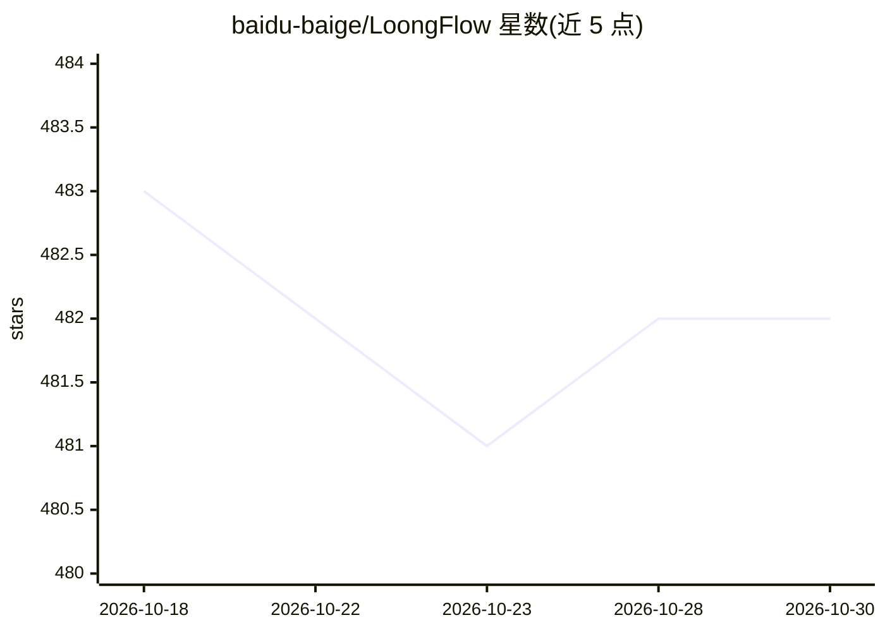

# baidu-baige/LoongFlow

⭐ 482 · Python · Apache-2.0 · 推送 2026-04-09 · [GitHub](https://github.com/baidu-baige/LoongFlow) · [官网](https://arxiv.org/abs/2512.24077) · 组织维护 · 中文 README

**专家级 Agent 开发框架：以计划-执行-总结循环持续学习进化**

百度开源的 Agent 开发框架，围绕 PES（Plan–Execute–Summary）思考范式组织 Agent 行为：每轮迭代先规划蓝图、再结构化实验、最后反思并将经验写入结构化记忆。记忆系统结合 Multi-Island 与 MAP-Elites 保持多样性、自适应 Boltzmann 选择与全局进化树。面向开发者构建通用编程、数学与机器学习三类 Agent 示例；README 列出在 Tao/AlphaEvolve 数学题集与 MLE-bench Kaggle 挑战上的结果。要求 Python 3.12+，通过克隆仓库并以 uv/conda 配置环境运行，模型经 task_config.yaml 或环境变量配置（默认 openai provider，支持 Anthropic 兼容模型）。

## 筛选速览

| 维度 | 判定 | 备注 |
|---|---|---|
| AI 角色 | `ai-ecosystem` | LLM/agent 周边工具 |
| 许可风险 | `permissive` | Apache-2.0 |
| 部署形态 | `library` | 以包/库形式分发 |
| 模型依赖 | — | README 未给出锁定关系 |
| 硬件要求 | — | 无带数字的原话,不猜 |
| 安装摩擦 | `low` | 无编译、无系统依赖或容器化 |
| 成熟度 | — | 结构信号不足 |

## 能力要点

- PES（Plan–Execute–Summary）结构化思考循环
- 多结构融合记忆：Multi-Island + MAP-Elites + 全局进化树
- 提供 General/Math/ML 三类 Agent 示例工程
- README 列出数学题集与 MLE-bench 挑战的结果数据

## 适用场景

- 构建需要长期推理的编程、数学或机器学习 Agent
- 让 Agent 在任务迭代中积累并复用经验
- 复现框架附带的 Kaggle/几何优化示例任务

## 场景标签

`Agent 框架` · 领域:Agent 开发

## 证据(README 行号)

> L7: LoongFlow is an open-source **expert-grade Agent development framework**.
> L61: **An expert-grade Agent framework that thinks and learns. It empowers Agents to think like scientists, helping deve

## 星数曲线

2026-10-18 483 → 2026-10-30 482（-1）

---
*卡片 v1 · prompt 1.4 · 生成 2026-10-21 · 置信度 high · 依据 README sha `2137ede8190a` · [字段定义](../../DATASET.md)*
