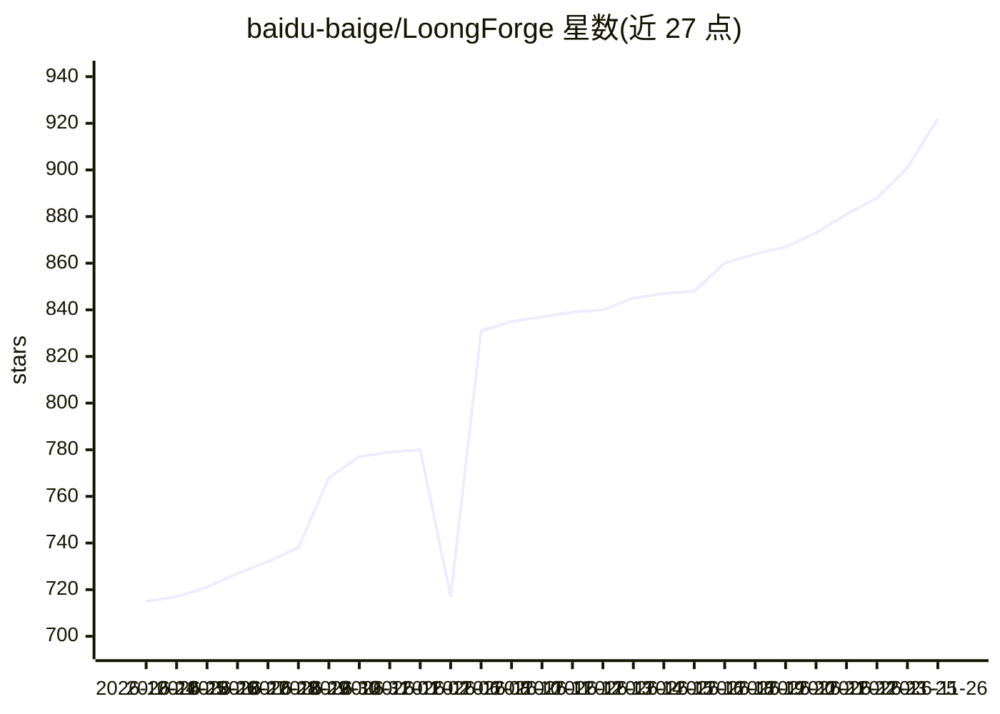

# baidu-baige/LoongForge

⭐ 922 · Python · Apache-2.0 · 推送 2026-11-25 · [GitHub](https://github.com/baidu-baige/LoongForge) · [官网](https://baidu-baige.github.io/LoongForge/) · 组织维护 · 中文 README

**百度开源的多后端大模型与具身模型训练框架**

由百度智能云千帆团队开发的开源训练框架，采用多后端架构：Megatron 后端覆盖 LLM、VLM 与扩散模型的预训练、mid-training、SFT 与 LoRA；torch-native 后端面向具身模型（VLA/WAM），支持 DDP/ZeRO-1/FSDP/HSDP 分布式策略。提供 40+ 开源模型的配置与启动脚本、checkpoint 转换与数据预处理工具，原生支持 NVIDIA GPU 与昆仑 XPU，提供统一预构建 Docker 镜像，含 LIBERO 等仿真器的统一评测模块。

## 筛选速览

| 维度 | 判定 | 备注 |
|---|---|---|
| AI 角色 | `ai-ecosystem` | LLM/agent 周边工具 |
| 许可风险 | `permissive` | Apache-2.0 |
| 部署形态 | `self-host` | docker 或自建部署 |
| 模型依赖 | locked-api |  |
| 硬件要求 | — | 无带数字的原话,不猜 |
| 安装摩擦 | `low` | 无编译、无系统依赖或容器化 |
| 成熟度 | — | 结构信号不足 |

## 能力要点

- Megatron 与 torch-native 双后端，覆盖 LLM/VLM/扩散/具身四类模型
- 支持预训练、mid-training、SFT、LoRA，附带 40+ 模型配置与脚本
- Megatron ↔ HuggingFace 双向转换与在线原生 HF 加载
- VLA/WAM 数据处理、训练与 LIBERO/CALVIN/SimplerEnv 等仿真器闭环评测

## 适用场景

- 在企业级 GPU/XPU 集群上对大模型做大规模预训练或 SFT
- 训练与评测 Pi0.5、GR00T 等具身 VLA 模型
- 将第一人称操作视频转换为机器人训练数据（ego2robot）
- 通过配置组合 ViT 与 LLM 组件构建自定义 VLM

## 场景标签

`模型训练` `微调` `模型评测` · 领域:评测与运维

## 证据(README 行号)

> L33: **LoongForge** is an open-source training framework developed by the Baidu AI Cloud Baige team, built to deliver fa
> L51: Since optimal training strategies differ across model families and scales, LoongForge adopts a multi-backend archit
> L56: - **torch-native Backend** — For embodied models (VLA and WAM). Built on native PyTorch with **DDP / ZeRO-1 / FSDP 

## 星数曲线

2026-10-24 715 → 2026-11-26 922（+207）

---
*卡片 v1 · prompt 1.4 · 生成 2026-11-26 · 置信度 high · 依据 README sha `48fad0b62d50` · [字段定义](../../DATASET.md)*
