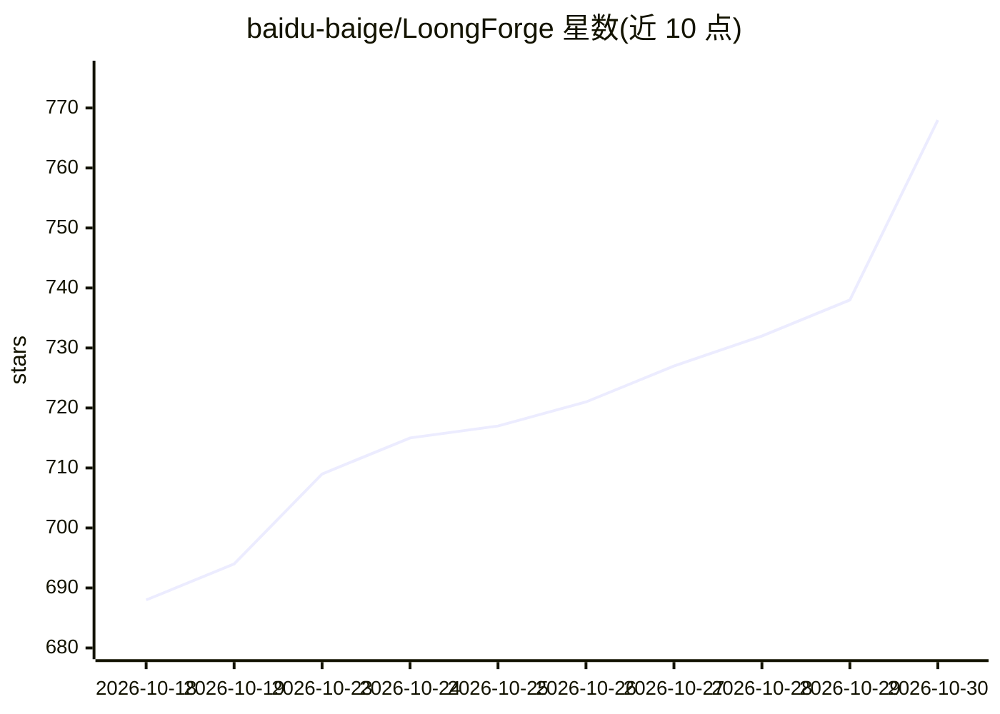

# baidu-baige/LoongForge

⭐ 768 · Python · Apache-2.0 · 推送 2026-10-29 · [GitHub](https://github.com/baidu-baige/LoongForge) · [官网](https://baidu-baige.github.io/LoongForge/) · 组织维护 · 中文 README

**百度百度的多模态大模型与具身模型训练框架**

由百度智能云百炼团队开源的训练框架，基于 Megatron-LM 与 torch-native 双后端，覆盖 LLM、VLM、扩散模型与具身模型（VLA/WAM）的预训练、mid-training、SFT 与 LoRA，提供 40+ 开源模型的开箱配置与启动脚本、checkpoint 转换和数据预处理工具。具身部分含数据处理、训练与 LIBERO/CALVIN 等仿真评测闭环，并附 ego2robot 视频转机器人训练数据管线。原生支持 NVIDIA GPU 与昆仑 XPU，生产运行规模达 5,000+ XPU。以 Docker 镜像为主要分发方式。

## 筛选速览

| 维度 | 判定 | 备注 |
|---|---|---|
| AI 角色 | `ai-ecosystem` | LLM/agent 周边工具 |
| 许可风险 | `permissive` | Apache-2.0 |
| 部署形态 | `self-host` | docker 或自建部署 |
| 模型依赖 | — | README 未给出锁定关系 |
| 硬件要求 | — | 无带数字的原话,不猜 |
| 安装摩擦 | `low` | 无编译、无系统依赖或容器化 |
| 成熟度 | — | 结构信号不足 |

## 能力要点

- Megatron + torch-native 双后端架构，覆盖 LLM/VLM/扩散/具身四类模型
- 40+ 开源模型的开箱配置与启动脚本（examples/ 与 examples_xpu/）
- 支持 DDP/ZeRO-1/FSDP/HSDP、FP8 通信优化、MoE 专家负载均衡（TAOT）
- 具身模型数据-训练-仿真评测闭环，含 ego2robot 数据管线

## 适用场景

- 在 NVIDIA GPU 或昆仑 XPU 集群上预训练/微调主流开源大模型
- 训练 Pi0.5、GR00T、DreamZero 等具身 VLA/WAM 模型
- 通过 Megatron↔HuggingFace 转换对接已有模型生态

## 场景标签

`模型训练` `微调` · 领域:训练与推理

## 证据(README 行号)

> L33: **LoongForge** is an open-source training framework developed by the Baidu AI Cloud Baige team, built to deliver fa
> L35: - **High Performance** — Built on Megatron-LM and torch-native backends, with deep optimizations for training speed
> L146: * **Heterogeneous Hardware** — Native support for **NVIDIA GPUs** and **Kunlun XPUs** via a minimally-intrusive pl

## 星数曲线

2026-10-18 688 → 2026-10-30 768（+80）

---
*卡片 v1 · prompt 1.4 · 生成 2026-10-22 · 置信度 high · 依据 README sha `3fc25e0b9e4c` · [字段定义](../../DATASET.md)*
