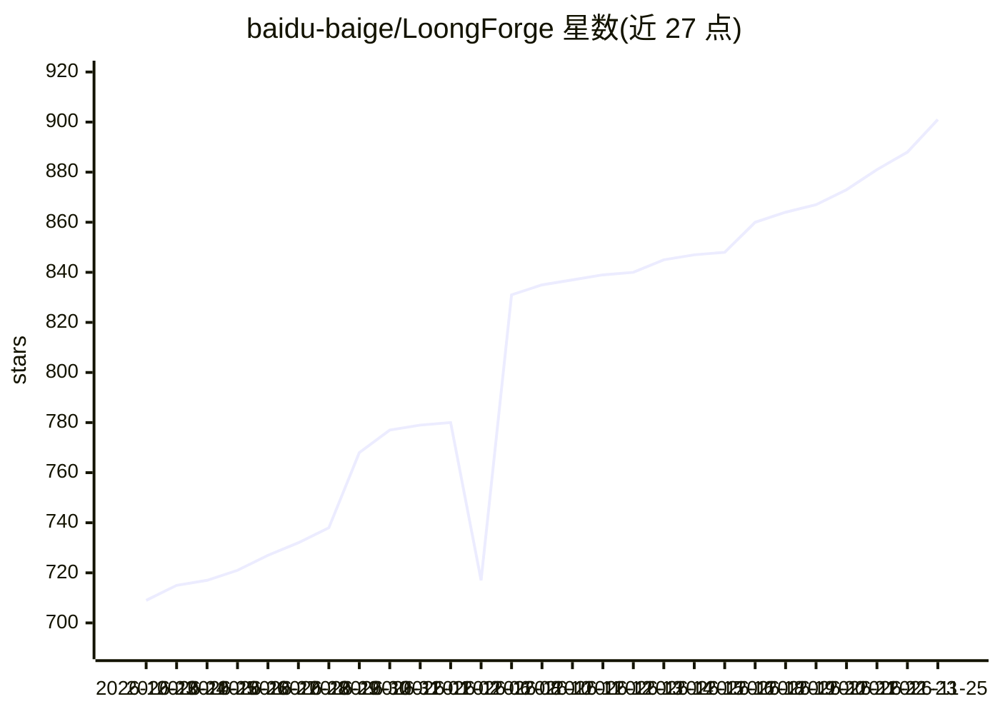

# baidu-baige/LoongForge

⭐ 901 · Python · Apache-2.0 · 推送 2026-11-23 · [GitHub](https://github.com/baidu-baige/LoongForge) · [官网](https://baidu-baige.github.io/LoongForge/) · 组织维护 · 中文 README

**百度开源的训练框架：在 GPU/XPU 上训练 LLM、VLM 与具身模型**

LoongForge 是百度智能云百 teams 团队开源的训练框架，基于 Megatron-LM 与 torch-native 双后端架构：Megatron 后端面向 LLM、VLM 与扩散模型，torch-native 后端面向具身模型（VLA/WAM）。支持预训练、mid-training、SFT 与 LoRA，提供 40+ 模型的现成配置与启动脚本、checkpoint 转换与数据预处理工具，原生支持 NVIDIA GPU 与昆仑 XPU，提供预构建 Docker 镜像。源自 AIAK-Training-LLM，采用 Apache 2.0 许可。

## 筛选速览

| 维度 | 判定 | 备注 |
|---|---|---|
| AI 角色 | `ai-ecosystem` | LLM/agent 周边工具 |
| 许可风险 | `permissive` | Apache-2.0 |
| 部署形态 | `self-host` | docker 或自建部署 |
| 模型依赖 | — | README 未给出锁定关系 |
| 硬件要求 | — | 无带数字的原话,不猜 |
| 安装摩擦 | `low` | 无编译、无系统依赖或容器化 |
| 成熟度 | `idea` | |

## 能力要点

- 双后端架构：Megatron 后端（LLM/VLM/扩散）+ torch-native 后端（具身模型 DDP/ZeRO-1/FSDP/HSDP）
- 支持预训练、mid-training、SFT、LoRA，提供 40+ 模型的配置与启动脚本
- 具身模型统一数据加载（LeRobot v2/v3）与 LIBERO/CALVIN/SimplerEnv 等仿真器闭环评测
- Megatron ↔ HuggingFace 双向转换与在线 HF 加载/保存

## 适用场景

- 在 NVIDIA GPU 或昆仑 XPU 集群上做 LLM/VLM 大规模预训练与 SFT
- 训练 Pi0.5、GR00T 等具身 VLA 模型并在仿真器中评测
- 将第一人称操作视频转换为多机器人形态的 LeRobot 训练数据
- VLM 灵活组合（ViT 与 LLM 组件互换）而无需自定义模型代码

## 场景标签

`模型训练` `微调` `模型评测` · 领域:评测与运维

## 证据(README 行号)

> L33: **LoongForge** is an open-source training framework developed by the Baidu AI Cloud Baige team, built to deliver fa
> L55: - **Megatron Backend** — For LLM, VLM, and diffusion models, extended with MoE parallelism, per-component heterogen
> L56: - **torch-native Backend** — For embodied models (VLA and WAM). Built on native PyTorch with **DDP / ZeRO-1 / FSDP 

## 星数曲线

2026-10-23 709 → 2026-11-25 901（+192）

---
*卡片 v1 · prompt 1.4 · 生成 2026-11-24 · 置信度 high · 依据 README sha `102a098f4be5` · [字段定义](../../DATASET.md)*
