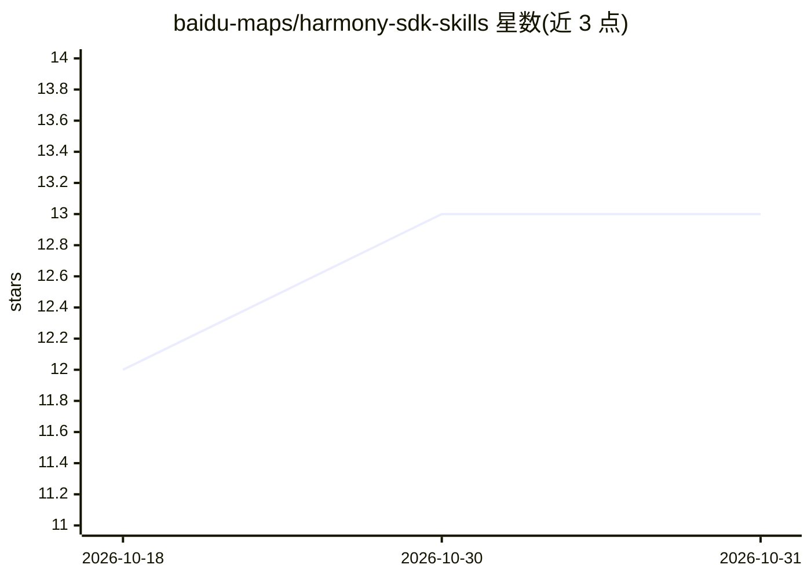

# baidu-maps/harmony-sdk-skills

⭐ 13 · 推送 2026-03-11 · [GitHub](https://github.com/baidu-maps/harmony-sdk-skills) · 组织维护 · 中文 README

**面向 HarmonyOS 百度地图的 AI Coding Agent Skills 集合**

提供三个 AI Coding Agent Skill：百度地图鸿蒙 SDK 开发助手（覆盖地图展示、覆盖物、检索、路线规划、导航、定位与工具类能力）、HarmonyOS ArkTS 开发规范助手、以及鸿蒙空工程模板生成器。开发者将 skills 目录软链或复制到 Claude Code（~/.claude/skills/）或 Cursor（~/.cursor/skills-cursor/）的 skills 目录后，AI 助手在对话中会读取这些文档作答。环境要求 HarmonyOS NEXT Developer Preview1 及以上、ArkTS API 12+、华为手机。许可证为百度内部项目，仅供授权使用。

## 筛选速览

| 维度 | 判定 | 备注 |
|---|---|---|
| AI 角色 | `ai-knowledge` | 知识聚合/清单类 |
| 许可风险 | `none` | — |
| 部署形态 | `None` |  |
| 模型依赖 | — | README 未给出锁定关系 |
| 硬件要求 | — | 无带数字的原话,不猜 |
| 安装摩擦 | `low` | 无编译、无系统依赖或容器化 |
| 成熟度 | — | 结构信号不足 |

## 能力要点

- 三个 Skill：地图 SDK 助手、ArkTS 规范助手、鸿蒙空工程模板生成器
- 覆盖地图、检索、路线规划、导航、定位等 SDK 能力文档
- 支持注册到 Claude Code 与 Cursor 的 skills 目录

## 适用场景

- 在 AI 编码助手中开发百度地图鸿蒙应用
- 按 ArkTS 规范生成或重构 ArkTS/ArkUI 代码
- 从零生成 HarmonyOS NEXT 标准空工程

## 场景标签

 · 领域:移动开发/地图 SDK

## 证据(README 行号)

> L3: 本仓库提供一组面向 **HarmonyOS NEXT 百度地图** 平台的 AI Coding Agent Skills，帮助开发者在智能研发工具（如 Cursor / Claude Code等）中高效完成鸿蒙应用的创建、地图 SD

## 星数曲线

2026-10-18 12 → 2026-10-31 13（+1）

---
*卡片 v1 · prompt 1.4 · 生成 2026-10-31 · 置信度 high · 依据 README sha `70197443a0a0` · [字段定义](../../DATASET.md)*
