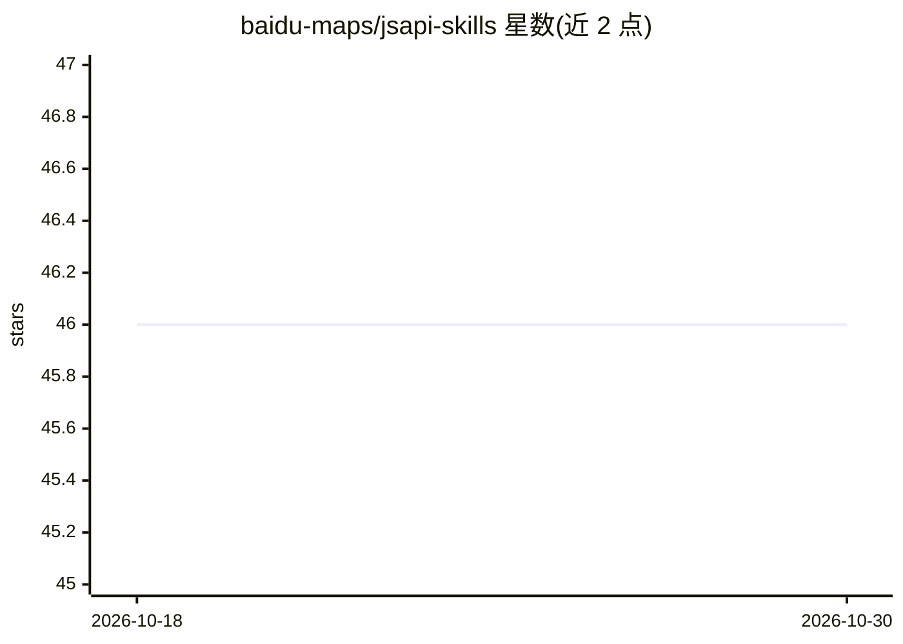

# baidu-maps/jsapi-skills

⭐ 46 · 推送 2026-09-07 · [GitHub](https://github.com/baidu-maps/jsapi-skills) · 组织维护 · 中文 README

**百度地图 JSAPI 的 AI 助手技能包，供 Claude/Cursor 引用参考文档**

由百度地图团队维护的 AI 助手 Skills 集合：将百度地图 JSAPI 的参考文档与示例组织为 4 个 SKILL.md 格式技能（WebGL 版、v4.0 版、基于 three.js 的 2D/3D 一体化可视化库、UI 组件库），安装到 Claude Desktop 或 Cursor 的 skills 目录后，助手在用户提问涉及百度地图 API 时加载对应文档，输出匹配 JSAPI 的回答与代码。提供 npx skills add 一键安装与手动克隆/下载 zip 后符号链接两种方式。

## 筛选速览

| 维度 | 判定 | 备注 |
|---|---|---|
| AI 角色 | `ai-knowledge` | 知识聚合/清单类 |
| 许可风险 | `none` | — |
| 部署形态 | `desktop` | 安装包/桌面程序 |
| 模型依赖 | — | README 未给出锁定关系 |
| 硬件要求 | — | 无带数字的原话,不猜 |
| 安装摩擦 | `low` | 无编译、无系统依赖或容器化 |
| 成熟度 | — | 结构信号不足 |

## 能力要点

- 4 个技能覆盖 JSAPI WebGL 版、v4.0、MapVThree 2D/3D 可视化与 UI 组件库
- 通过 SKILL.md 列出参考文件供 AI 按需加载
- 支持 npx skills add 一键安装
- 提供 Claude Desktop 与 Cursor 的手动注册路径

## 适用场景

- 用 Claude/Cursor 开发百度地图 JSAPI 时让 AI 引用准确文档
- 构建基于 MapVThree 的 2D/3D 地图与数字孪生应用时获得 API 参考
- 快速集成地点搜索、POI 详情等标准化地图 UI 组件

## 场景标签

 · 领域:地图服务/前端开发

## 证据(README 行号)

> L5: This repository provides AI assistant **Skills** for Baidu Map JSAPI. Use them with Claude, Cursor, or other clients
> L88: `SKILL.md` lists all reference files so the AI can load them as needed.

## 星数曲线

2026-10-18 46 → 2026-10-30 46（+0）

---
*卡片 v1 · prompt 1.4 · 生成 2026-10-25 · 置信度 high · 依据 README sha `ead61a3b7dff` · [字段定义](../../DATASET.md)*
