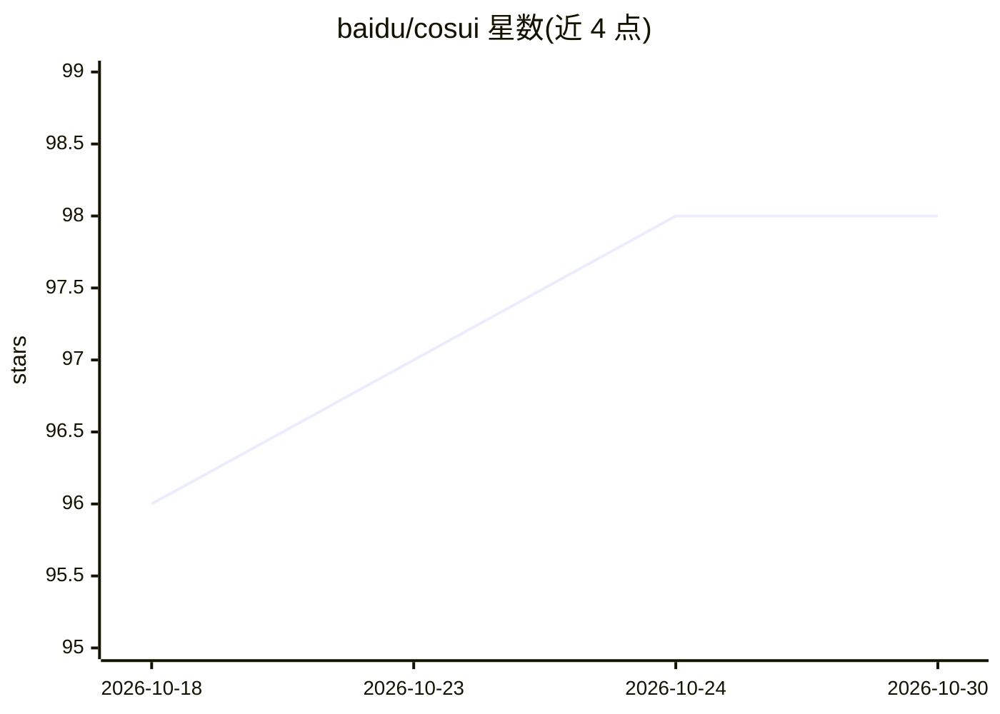

# baidu/cosui

⭐ 98 · TypeScript · Apache-2.0 · 推送 2026-06-09 · [GitHub](https://github.com/baidu/cosui) · [官网](https://baidu.github.io/cosui/) · 组织维护 · 中文 README

**面向 AI 应用的前端 UI 解决方案：UI 协议、渲染 SDK 与组件库**

百度开源的 AI 时代前端 UI 解决方案，包含三部分：数据驱动渲染的 UI 协议（Markdown 扩展协议与 JSON 动态协议，支持结构化展现与动态交互）、UI 解析渲染 SDK、以及基于 San 框架的组件库 @cosui/cosmic。组件库采用 Cosmic Design Token 设计系统，支持 H5 与 PC 双端、自定义主题、按需加载，组件按基础与行业场景分层。另提供平台化管理能力（设计到代码工具化输出）。通过 npm 安装，面向构建生成式 UI、智能体、AI 对话应用的前端开发者。

## 筛选速览

| 维度 | 判定 | 备注 |
|---|---|---|
| AI 角色 | `ai-ecosystem` | LLM/agent 周边工具 |
| 许可风险 | `permissive` | Apache-2.0 |
| 部署形态 | `library` | 以包/库形式分发 |
| 模型依赖 | — | README 未给出锁定关系 |
| 硬件要求 | — | 无带数字的原话,不猜 |
| 安装摩擦 | `low` | 无编译、无系统依赖或容器化 |
| 成熟度 | — | 结构信号不足 |

## 能力要点

- Markdown 扩展协议与 JSON 动态协议，数据驱动渲染
- UI 解析渲染 SDK（Markdown 扩展与 JSON 协议解析及渲染）
- 基于 San 与 Cosmic Design Token 的组件库，多端适配、按需加载
- 平台化管理：设计到代码工具化输出

## 适用场景

- 为 AI 对话/智能体应用渲染结构化、可交互的生成式 UI
- 构建支持 Markdown 扩展与 JSON 动态协议的前端界面
- 多端（H5/PC）AI 应用的组件库选型

## 场景标签

 · 领域:前端/UI 基础设施

## 证据(README 行号)

> L9: 一套面向 AI 时代的前端 UI 解决方案，包含 UI 协议、解析渲染 SDK 与 UI 组件库等，可应用于生成式 UI、智能体、AI 对话等多种大模型场景。
> L13: - 数据驱动渲染的 UI 协议
> L17: - UI 解析渲染 SDK：包含 Markdown 扩展协议解析渲染、JSON 协议解析及渲染的完整 SDK 解决方案

## 星数曲线

2026-10-18 96 → 2026-10-30 98（+2）

---
*卡片 v1 · prompt 1.4 · 生成 2026-10-23 · 置信度 high · 依据 README sha `dfeebf8fdfd7` · [字段定义](../../DATASET.md)*
