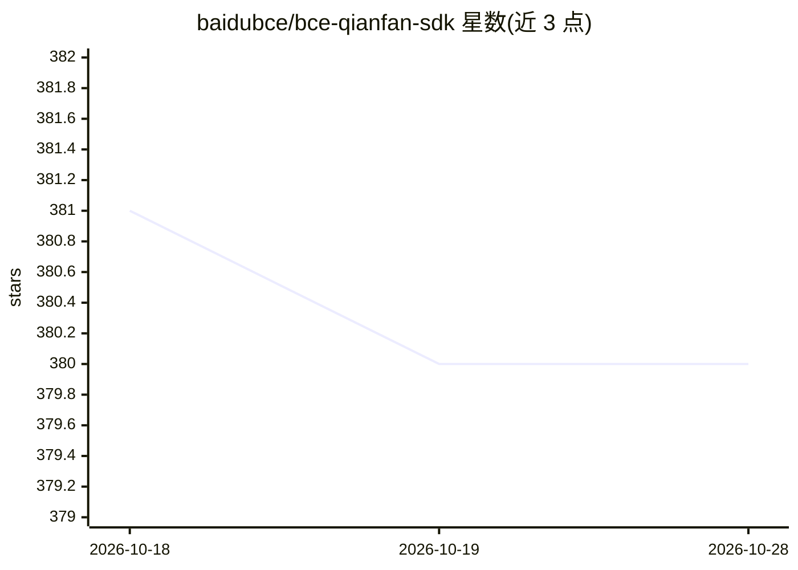

# baidubce/bce-qianfan-sdk

⭐ 380 · Jupyter Notebook · Apache-2.0 · 推送 2025-12-12 · [GitHub](https://github.com/baidubce/bce-qianfan-sdk) · [官网](https://cloud.baidu.com/doc/WENXINWORKSHOP/index.html) · 组织维护 · 中文 README

**访问百度千帆大模型平台的多语言官方 SDK**

百度千帆平台 SDK，提供 Python/Go/Java/JavaScript 四种语言版本，封装大模型推理（对话、补全、Embedding、文生图、重排序等）、大模型训练（Dataset/Trainer/Model 全流程精调与预训练）及 Prompt 管理、命令行工具等通用能力。鉴权支持 Access Key/Secret Key 与 API Key 两种方式，后者不适用于训练与模型管理功能；推理服务提供 OpenAI 兼容接口。

## 筛选速览

| 维度 | 判定 | 备注 |
|---|---|---|
| AI 角色 | `ai-ecosystem` | LLM/agent 周边工具 |
| 许可风险 | `permissive` | Apache-2.0 |
| 部署形态 | `library` | 以包/库形式分发 |
| 模型依赖 | — | README 未给出锁定关系 |
| 硬件要求 | — | 无带数字的原话,不猜 |
| 安装摩擦 | `low` | 无编译、无系统依赖或容器化 |
| 成熟度 | — | 结构信号不足 |

## 能力要点

- Python/Go/Java/JS 四语言 SDK，Python 版发布于 PyPI
- 推理封装：Chat/Completion/Embedding/Plugin/文生图/图生文/Reranker，支持异步与流式
- 训练链路：Dataset 加载与本地处理、Trainer Pipeline 精调、模型评估与批量推理
- 推理服务 V2 提供 OpenAI SDK 兼容调用方式

## 适用场景

- 在代码中调用千帆平台的 ERNIE 系列及开源模型推理
- 用 Dataset/Trainer 流程对模型进行精调和评估
- 通过内置命令行工具在终端直接与千帆平台交互
- 用 OpenAI SDK 兼容方式接入千帆模型服务

## 场景标签

`图像生成` `微调` `模型训练` · 领域:内容生成

## 证据(README 行号)

> L30: 千帆 SDK 提供大模型工具链最佳实践，让 AI 工作流和 AI 原生应用优雅且便捷地访问千帆大模型平台。SDK 核心能力包含三大部分：大模型推理，大模型训练，以及通用和扩展:
> L34: - `通用与扩展`：通用能力包括了 Prompt/Debug/Client 等常见的 AI 开发工具。扩展能力则基于千帆特性适配常见的中间层框架。

## 星数曲线

2026-10-18 381 → 2026-10-28 380（-1）

---
*卡片 v1 · prompt 1.4 · 生成 2026-10-22 · 置信度 high · 依据 README sha `deee2a31260a` · [字段定义](../../DATASET.md)*
