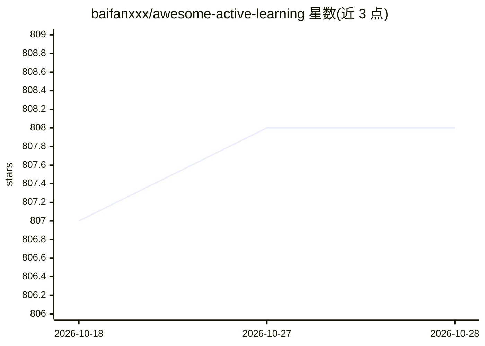

# baifanxxx/awesome-active-learning

⭐ 808 · CC0-1.0 · 推送 2026-03-26 · [GitHub](https://github.com/baifanxxx/awesome-active-learning) · 个人维护

**主动学习（Active Learning）论文与资源策展清单**

个人维护的 awesome 类策展清单，收录主动学习领域的书籍、综述、评测基准与按年份（2019-2026）组织的论文条目。每条含会议、论文链接、代码链接、标签（如 pool-based、半监督、少样本）与备注。领域覆盖图像分类、目标检测、语义分割、NLP、医学影像、语音等场景，并以贡献格式与标签体系（L33-36）组织条目。不提供软件安装，仅作文献导航。

## 筛选速览

| 维度 | 判定 | 备注 |
|---|---|---|
| AI 角色 | `ai-knowledge` | 知识聚合/清单类 |
| 许可风险 | `viral` | CC0-1.0 |
| 部署形态 | `None` |  |
| 模型依赖 | — | README 未给出锁定关系 |
| 硬件要求 | — | 无带数字的原话,不猜 |
| 安装摩擦 | `low` | 无编译、无系统依赖或容器化 |
| 成熟度 | — | 结构信号不足 |

## 能力要点

- 按年份组织论文条目，附会议、代码链接与标签
- 覆盖综述、书籍、评测基准三类资源
- 标签体系区分 pool-based/stream-based/半监督/少样本等方向

## 适用场景

- 查找主动学习方向的代表性论文与开源代码
- 调研主动学习在检测、分割、NLP、医学影像等任务上的应用
- 通过综述与评测基准了解该领域研究脉络

## 场景标签

`精选清单` `科研工具` · 领域:学习与行业

## 证据(README 行号)

> L3: 🤩 A curated list of awesome Active Learning ! 🤩
> L25: If you find the awesome paper/code/book/tutorial or have some suggestions, please feel free to pull requests or con

## 星数曲线

2026-10-18 807 → 2026-10-28 808（+1）

---
*卡片 v1 · prompt 1.4 · 生成 2026-10-21 · 置信度 high · 依据 README sha `1a1e44ea7cdc` · [字段定义](../../DATASET.md)*
