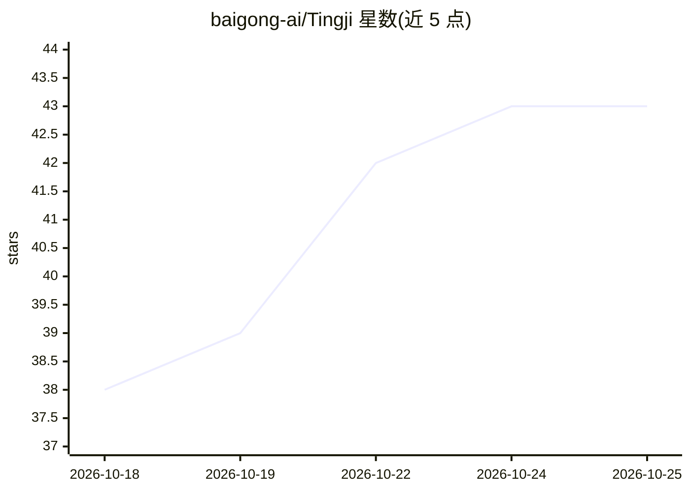

# baigong-ai/Tingji

⭐ 43 · Python · 推送 2026-09-16 · [GitHub](https://github.com/baigong-ai/Tingji) · 组织维护 · 中文 README

**本地离线会议录音转写与纪要工具：录音进、原文+纪要出**

自托管的本地会议转写应用：基于 FunASR（paraformer ASR + VAD + 标点 + CAM++ 说话人分离）完成识别，再由 LLM（本地 Ollama 或 OpenAI 兼容 API）生成整理稿与概述/决议/待办/待讨论四段结构化纪要。支持逐句时间戳、原文↔整理对照、纪要时间戳回跳、个人笔记层、议题时间轴、热词校对、批量上传、实时流式转写与历史会议管理；数据全程留本机。跨平台（macOS / WSL2+GPU），Python 3.11 + uv，源码部署，首次启动下载约 1.3 GB 模型。限制：无用户认证，仅适合本地或可信局域网。

## 筛选速览

| 维度 | 判定 | 备注 |
|---|---|---|
| AI 角色 | `ai-native` | 本体是模型或模型工具 |
| 许可风险 | `none` | — |
| 部署形态 | `None` |  |
| 模型依赖 | local-ok | 支持本地模型 |
| 硬件要求 | — | 无带数字的原话,不猜 |
| 安装摩擦 | `medium` | 含编译或系统依赖之一 |
| 成熟度 | — | 结构信号不足 |

## 能力要点

- FunASR 本地识别：ASR + 说话人分离 + 标点恢复，识别无需联网
- LLM 整理生成四段结构化纪要，条目带可点击时间戳回跳音频
- 实时流式转写：断线自动重连、10 分钟宽限期无缝续录
- FunASR 模型闲置自动卸载（默认 30 分钟，可配置）

## 适用场景

- 会议/访谈/讲座长音频的本地转写与纪要生成，数据不出本机
- 边开会边实时转写，会后校对热词再一键整理
- 对纪要决议/待办逐条回跳音频现场核对

## 场景标签

`语音识别` `AI 写作` · 领域:内容生成

## 证据(README 行号)

> L5: > 本地会议录音转写与纪要：把录音丢进去，自动得到原文、整理稿和会议纪要。数据全程留在你自己的电脑上。
> L11: 基于 FunASR（语音识别 + 说话人分离 + 标点恢复）与大语言模型整理。适合**会议、访谈、讲座**等长音频；跨平台（macOS / Windows WSL2 + GPU），识别无需联网。
> L277: **本地处理优先**是本项目的基本原则：识别（ASR）全程本地，整理/总结默认也走本地 Ollama，会议内容不出你的机器。在线 API 只是可选增强，适合本地模型力不从心时手动切换。

## 星数曲线

2026-10-18 38 → 2026-10-25 43（+5）

---
*卡片 v1 · prompt 1.4 · 生成 2026-10-25 · 置信度 high · 依据 README sha `cea58e44d6ef` · [字段定义](../../DATASET.md)*
