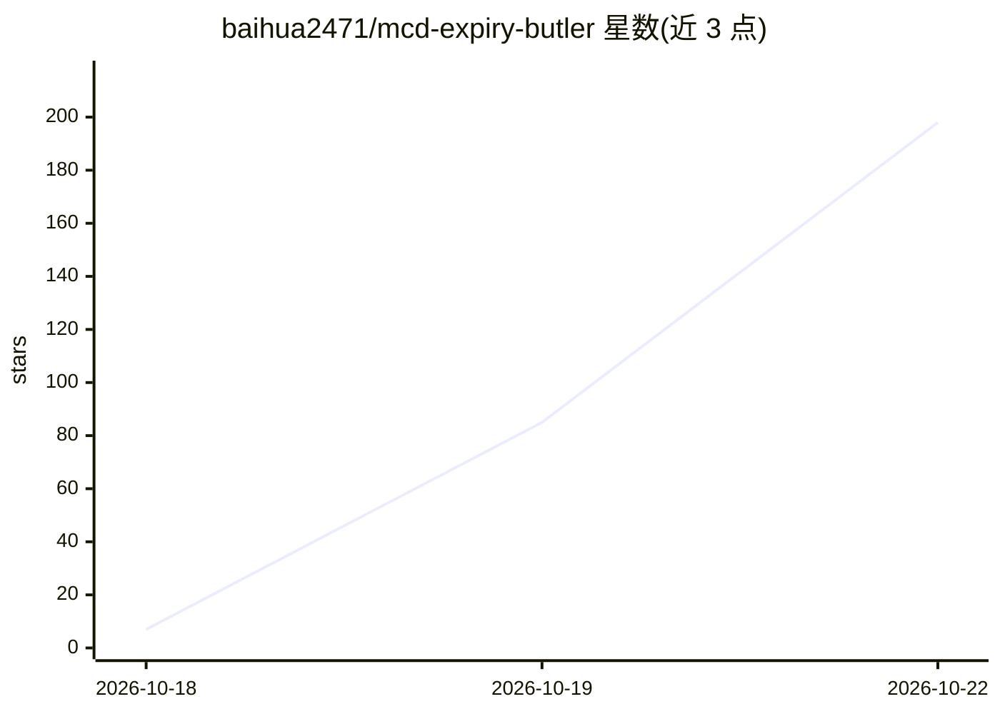

# baihua2471/mcd-expiry-butler

⭐ 198 · Python · NOASSERTION · 推送 2026-10-12 · [GitHub](https://github.com/baihua2471/mcd-expiry-butler) · [官网](【WorkBuddy】当前有接入麦当劳的MCP吗 ，如果没有，配置下 ardot-design-core ardot-design-router https://workbuddy.link/p/RZciPqwzx2l3LHYKDkrjvE?ext2=copy_link) · 个人维护 · 中文 README

**查询麦当劳优惠券与积分到期情况并按预算给方案**

基于麦当劳官方 MCP 的 WorkBuddy Skill，面向消费者：只读查询用户优惠券与积分，列出快到期权益（默认 7 天窗口，可调），按用户给出的预算、就餐方式与门店筛选可用券，对每个候选方案调用官方 calculate-price 接口试算，输出最多两套含已验证应付金额的方案及不建议使用清单。不执行领券、下单、兑换等写操作，不做价格估算，缺数据时标注缺失。Python 3.9+ 仅标准库，另提供不需账号的演示模式。

## 筛选速览

| 维度 | 判定 | 备注 |
|---|---|---|
| AI 角色 | `ai-native` | 本体是模型或模型工具 |
| 许可风险 | `none` | NOASSERTION |
| 部署形态 | `library` | 以包/库形式分发 |
| 模型依赖 | — | README 未给出锁定关系 |
| 硬件要求 | — | 无带数字的原话,不猜 |
| 安装摩擦 | `low` | 无编译、无系统依赖或容器化 |
| 成熟度 | — | 结构信号不足 |

## 能力要点

- 只读查询优惠券与积分，列出到期窗口与剩余天数
- 候选方案经官方 calculate-price 接口试算，输出已验证金额
- 最多两套方案 + 不建议使用清单 + 未确认条件
- 真实查询失败不静默切换演示数据

## 适用场景

- 点单前查看哪些券快到期、真正可用
- 按预算（如 30 元一次）获得经试算的用餐方案
- 避免为消耗到期权益而额外花钱

## 场景标签

 · 领域:生活服务/消费工具

## 证据(README 行号)

> L7: 一个真实使用**麦当劳 MCP** 的 WorkBuddy Skill：只读查询你的优惠券与积分，按预算给出**最多两套**用餐方案，
> L25: - 对每个候选方案调用官方价格试算，给出**已验证**应付金额

## 星数曲线

2026-10-18 7 → 2026-10-22 198（+191）

---
*卡片 v1 · prompt 1.4 · 生成 2026-10-22 · 置信度 mid · 依据 README sha `27ae9776af73` · [字段定义](../../DATASET.md)*
