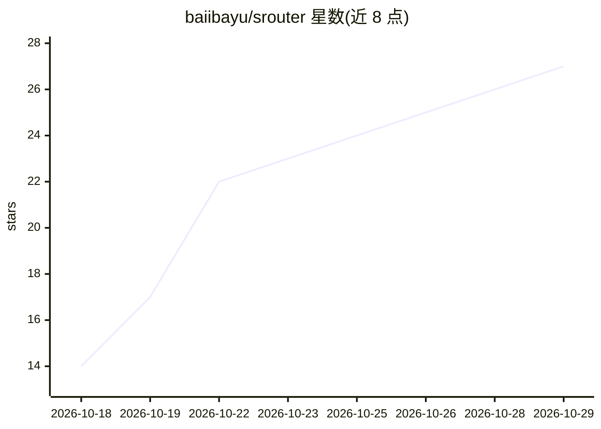

# baiibayu/srouter

⭐ 27 · TypeScript · MIT · 推送 2026-10-28 · [GitHub](https://github.com/baiibayu/srouter) · [官网](https://github.com/baiibayu/srouter) · 个人维护 · 中文 README

**自托管 AI 网关：统一 OpenAI 兼容端点聚合 60+ 提供商**

面向使用 AI 编程工具的开发者的自托管 LLM 路由与网关：将约 60 个提供商、约 1,200+ 模型端点聚合到单一 OpenAI 兼容端点，支持 Anthropic Messages、Gemini、Ollama 仿真等原生协议。机制包括三级自动回退（订阅→预算→免密钥免费层）、提示压缩、每日两次自动同步签名模型目录、本地 AES-256-GCM 加密存储密钥。提供 npm/npx、Docker Compose、桌面安装包与源码四种运行方式，并为 25+ 编程工具提供自动配置生成命令。

## 筛选速览

| 维度 | 判定 | 备注 |
|---|---|---|
| AI 角色 | `ai-ecosystem` | LLM/agent 周边工具 |
| 许可风险 | `permissive` | MIT |
| 部署形态 | `desktop` | 安装包/桌面程序 |
| 模型依赖 | local-ok | 支持本地模型 |
| 硬件要求 | — | 无带数字的原话,不猜 |
| 安装摩擦 | `low` | 无编译、无系统依赖或容器化 |
| 成熟度 | — | 结构信号不足 |

## 能力要点

- 单一 OpenAI 兼容端点聚合 ~60 提供商与 ~1,200+ 模型
- 三级自动回退链：订阅 → 预算 → 100% 免密钥免费层
- 提示压缩（结构感知过滤工具输出）
- Ed25519 签名模型目录每日两次自动同步，密钥本地加密存储

## 适用场景

- 编程 agent 撞到限流时自动切换到备用模型继续工作
- 把 Claude Code、Cursor 等多个工具接到同一个本地端点统一管理
- 聚合各家免费额度与本地 Ollama 模型供日常编码使用

## 场景标签

`模型网关` · 领域:Agent 开发

## 证据(README 行号)

> L5: **Never hit rate limits again. Save tokens with prompt compression + auto-fallback to ~60 free AI providers and ~1,2
> L7: **Connect all AI coding tools (Claude Code, Cursor, Windsurf, Cline, Codex, Copilot, Aider, OpenCode...) behind a si
> L55: |**SDK & API Fragmentation:** Juggling 50+ incompatible SDKs, auth formats, and endpoint URLs.|**One Universal `/v1

## 星数曲线

2026-10-18 14 → 2026-10-29 27（+13）

---
*卡片 v1 · prompt 1.4 · 生成 2026-10-27 · 置信度 high · 依据 README sha `e1b8ca5b397f` · [字段定义](../../DATASET.md)*
